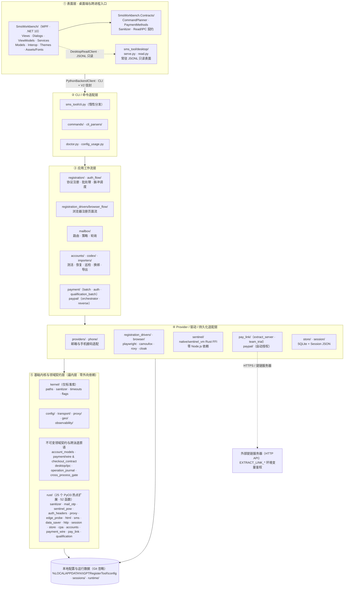

<div align="center">
  
  <h1>GPT-Register-Tool</h1>
  <p><strong>面向 Windows 的 ChatGPT 账号注册、邮箱 OTP、账号管理与支付链接提取工作台</strong><br>
  <em>A Windows desktop workbench for ChatGPT account registration, email OTP, account management, and payment-link extraction.</em></p>
  <p>
    <a href="./README.md">简体中文</a> · <a href="./README_EN.md">English</a>
  </p>
  <p>
    <a href="https://github.com/2951461586/GPT-Register-Tool/actions/workflows/ci.yml"></a>
    <a href="https://github.com/2951461586/GPT-Register-Tool/releases"></a>
    <a href="./LICENSE"></a>
    <a href="https://github.com/2951461586/GPT-Register-Tool/stargazers"></a>
    <a href="https://github.com/2951461586/GPT-Register-Tool/releases"></a>
  </p>
  <p>
    
    
    
    
  </p>
</div>

## 简介

GPT-Register-Tool 采用 **WPF (.NET 10) 桌面端 + Python 3.12+ 业务核心 + 原生 Rust 加速层**（内置 `native/sentinel_vm/` 进程内 Rust Sentinel VM，彻底移除 Node.js 依赖；并集成 25 个 `rust-anything` PyO3 热点扩展，覆盖脱敏、OTP/SMS 解析、Sentinel SHA3-512 PoW 求解、指纹头与协议解析、边缘探测挑战分类、支付线缆与资格状态分类、提链契约归一化、代理归一化/凭据掩码/地区改写与出口键重写、HTML 清洗、静态资源过滤、HTTP 回调/Cookie 处理、错误与重登恢复分类、JWT 离线解析、CPA 分类与会话转换），提供邮箱 OTP 注册、账号与 Session 管理、Plus 与 GPT Team 5 席位试用优惠检测及原生 Team 托管提链、代理池治理、统一提链服务器对接和账号导出能力。运行数据默认保存在本机，不写入 Git。

当前发布说明：[release-v2026.11.25.md](docs/releases/release-v2026.11.25.md)。


## 赞助商


[IPWO](https://www.ipwo.net)全球住宅代理为 ChatGPT 自动化工具提供全球住宅代理资源，支持多地区 IP 选择及灵活的代理配置。<br>
适用于注册代理、独立网络环境及自动化任务等场景，帮助开发者根据项目需求配置合适的网络出口。<br>
包含动态静态IP资源，支持免费测试。[IPWO测试入口](https://www.ipwo.net/?ref=githubGPT)


[ProxyLane](https://proxylane.dev/?utm_source=gpt-register-tool&utm_medium=partnership&utm_campaign=gpt-register-tool_sponsor_202610&utm_content=github_readme) 住宅代理覆盖 195 个国家，95%+ IP 获 Scamalytics 低风险评级，可按城市、ISP、ASN 定向。<br>
适合「账号 ↔ 代理槽绑定」：用户名后加会话名和城市，最长 72 小时同一个住宅 IP，换 IP 也留在同一城市。<br>
中文界面，支持 USDT 付款，首次购买使用优惠码 GPTREG30 享 7 折。

### 支持项目

[](https://buymeatokens.com/2951461586)

## 功能亮点

| 模块 | 能力要点 |
| --- | --- |
| **一键注册** | 邮箱池 / ReMail 长效邮箱 / CFWorker 域名邮箱 / iCloud 接码链接，配多供应商手机接码；单账号、并发批量与按目标成功数调度（`--target-success` + `--max-attempts`）；每个账号独立提取 Sentinel Token 与 `oai-did`，不跨账号复用认证事务；成功判定为 AT 探测 HTTP 200；注册只保存 AT/Session，不生成支付链接 |
| **协议一致性与恢复** | 领取或购买邮箱前预检 ChatGPT / Auth / Sentinel 三段网络；账号 ↔ 代理会话绑定，只在故障时换出口；NextAuth / Auth / ChatGPT 共享稳定的 `oai-did`、UA 与 client hints，指纹语言与时区随出口 GeoIP；403/429 熔断且不做纯 HTTP PoW 降级；创建账号后先持久化断点再探活，可从断点恢复且不重复烧 OTP |
| **邮箱与 OTP** | 统一 mailbox seam：ReMail、Smailr、CFWorker、Microsoft Graph/OAuth、Outlook/Hotmail IMAP、Gmail、iCloud 接码链接与历史邮箱池格式；OTP 按主题、发件人、精确收件人、服务端时间戳过滤并排序；ReMail 支持自适应轮询、详情正文补取与 30s 内重发 |
| **支付链接提取** | 目录共 16 种方式：15 种 Plus 协议方式（PayPal、GoPay、GCash、GrabPay、UPI、iDEAL、PIX、Kakao Pay、BLIK、TWINT、直卡 Checkout、MoMo、QRIS、Bizum、Naver Pay）统一经 `sms_tool/pay_link/extract_server.py` 对接外部提链服务器（CDK 仅经环境变量透传）；另原生内置 **GPT Team 5 席位试用托管提链**（`team_trial`，`sms_tool/pay_link/team_trial.py` 进程内直连 `POST /backend-api/payments/checkout`，无需外部 CDK，自动对齐账单国家并支持 `--team-workspace-name` / `--team-seat-quantity`）；保留只读能力探测、统一五态终态与原子断点续跑 |
| **原生 Rust 加速** | `native/sentinel_vm/` 编译为进程内 `sentinel_vm.dll` FFI，零 Node.js 运行时依赖；25 个 `rust-anything` PyO3 扩展加速 52 个热点函数（脱敏 8.3×、OTP 提取 6.9×/单函数最高 63×、Sentinel PoW 6.9×、错误分类 6.2×、支付线缆 Attestation/诊断压缩 4.6×/单函数 14.4×、HTML 清洗 4.0×/3.5×/3.0×、代理串解析/掩码/改写 3.4×/单函数 15×、指纹头解析 2.8×/单函数 8.9×、出口身份与恢复脱敏 2.4×/2.3×、提链契约归一化 2.0×、边缘探测分类 1.3× 等），零 `unsafe`、零 MinGW 运行时 DLL 依赖，详见 [Rust 原生加速架构](docs/current/rust-acceleration.md) |
| **账号与数据管理** | Session JSON + SQLite 双层索引；账号测活、离线 JWT 轻量快速盘点（`--inspect-accounts`）与增强型 401 恢复（独立 `relogin` 代理泳道轮询、OTP 前故障自动换出口、旧账号无密码 Email-OTP 自动回退与探活传输重试）；优惠状态徽章同时探测并持久化 Plus 试用与 **GPT Team 5 席位试用（`team-1-month-free`）** 机读资格标志；Codex / CPA / SUB2API 导入导出；本地数据在 `sessions/` 与 `runtime/`，均被 Git 忽略 |
| **桌面外壳** | 角色目录命名空间隔离（`Models` / `Services` / `ViewModels` / `Views` / `Dialogs` / `Interop`）+ 独立 Coordinator 编排；主题三态（跟随系统 / 浅色 / 深色，`System` 持续跟随 OS）；关闭窗口=隐藏到托盘，托盘菜单或 `Ctrl+Alt+R` 唤回，两个开关都可关；状态条实时显示吞吐/成功率/失败分类；代理池每行内联测速；工作区一键备份/恢复（配置 shard + 账号库 + 邮箱池 + UI 偏好，恢复前自动留旧副本） |
| **桌面端操作** | 勾选账号后走「支付链接提取」窗口（内置提链服务器配置、并发、重试、Canary、可折叠可选代理池、断点续跑）；注册批次每输出一次 `Saved session:` 即防抖刷新账号池；多选删除合并为一次后端批量命令；浏览器驱动支持 `--block-assets` 省流拦截静态图像/字体/媒体资源 |
| **手机接码** | SMSBower、HeroSMS、Grizzly、NexSMS 的供应商选择与在线目录查询（可用性依供应商协议），支持发送重试、超时与轮询间隔配置；详见 [当前接码契约](docs/current/one-click-sms.md) |


## 架构总览

项目按 **① 表面层 → ② CLI / 命令适配 → ③ 应用工作流 → ④ Provider / 驱动 / 持久化适配 → ⑤ 基础内核与领域契约** 五层组织（模块归属以 `scripts/layer_manifest.json` 为单一权威）：模块级导入严格向内（`source layer ≤ target layer`），下层绝不反向依赖上层，最内层 `sms_tool/kernel/` 仅允许依赖 Python 标准库。

桌面端（WPF · .NET 10）与 Python 核心之间采用**读写双通道**隔离，并通过仓库根目录的跨语言契约清单（`config_schema.json`、`ipc_schema.json`、`result_schema.json`、`sensitive_policy.json`、`payment_methods.json`）保持双向校验：

- **写路径（任务执行）**：`PythonBackendClient` 启动 `python -m sms_tool` 子进程执行注册、测活、换绑与批量支付；代理凭据经环境变量透传（不进入命令行 `argv`），stdout 经 `sms_tool/desktop/ipc.py` 输出版本化 `@@SMSWORKBENCH_V2@@` 进度/结果信封。
- **读路径（只读快照）**：`DesktopReadClient` 与 `sms_tool/desktop/serve.py` / `sms_tool/desktop/read.py` 维持常驻 JSONL 请求-响应通道（含一次性回退），用于账号池、邮箱池与短信目录的只读加载，不产生写副作用。

注册泳道分为**协议注册**（默认）与**浏览器驱动**两条，二者共用同一套邮箱 OTP、Session 提取与 AT HTTP 200 探活边界；配置分片与运行数据默认保存在仓库外（Git 忽略）。



每层的模块归属与职责边界：

| 层 | 模块 | 职责 |
| --- | --- | --- |
| ① 表面层（桌面端 UI） | `SmsWorkbench/`（`Views` · `Dialogs` · `ViewModels` · `Services` · `Models` · `Interop` · `Localization` · `Themes` · `Assets/Fonts/`） | Generic Host / DI、角色目录命名空间隔离、MVVM 主窗与全 XAML 弹窗、无窗口依赖 Coordinator、DeepAI 壳层-悬浮画布双主题（光/暗）与内嵌 `Atkinson Hyperlegible Next` 字体、可折叠日志/队列底栏、托盘与全局热键、工作区备份恢复 |
| ① 表面层（桌面契约与读通道） | `SmsWorkbench.Contracts/`、`sms_tool/desktop/serve.py`、`sms_tool/desktop/read.py` | 窗口无关的 CLI 命令规划（`BackendCommandPlanner`）、支付方式目录、敏感词脱敏、常驻 JSONL 只读快照服务与 `DesktopReadClient` 协议契约 |
| ② CLI / 命令适配 | `sms_tool/cli.py`、`sms_tool/commands/`、`sms_tool/cli_parsers/`、`sms_tool/doctor.py`、`sms_tool/config_usage.py` | 惰性命令分发、纯参数声明组、退出码映射与环境诊断；不承载 provider 协议实现或直接写库 |
| ③ 应用工作流（注册与认证） | `sms_tool/registration/`（`orchestrator.py` · `handlers.py` · `batch_runner.py` · `pulse.py`）、`sms_tool/auth_flow/`、`sms_tool/registration_drivers/browser_flow/` | 注册入口分派与 `RegistrationOperations` 不可变绑定、协议分阶段执行、目标成功数与脉冲调度、断点续跑、浏览器页面状态机；协议与浏览器两条泳道共用 OTP / Session / AT 200 边界 |
| ③ 应用工作流（邮箱 · 账号 · 支付编排） | `sms_tool/mailbox/`、`sms_tool/accounts/`、`sms_tool/codex/`、`sms_tool/importers/`、`sms_tool/payment/batch.py`、`sms_tool/payment/qualification_batch.py` | 邮箱路由/策略/轮询、存量账号测活/401 分层恢复/离线 JWT 巡检（`sms_tool/accounts/account_inspection.py`）/优惠与健康批处理/换绑/终端清理、Codex OAuth 与 CPA / SUB2API 导入导出、批量协议支付与支付资格编排 |
| ④ Provider / 驱动适配 | `sms_tool/providers/`、`sms_tool/phone/`、`sms_tool/registration_drivers/`、`sms_tool/browser/`、`sms_tool/sentinel/`、`sms_tool/registration/sentinel_tokens.py` | 邮箱与手机接码供应商客户端与号池复用；浏览器驱动（playwright · camoufox · roxy · cloak）、静态资源省流拦截（`sms_tool/registration_drivers/data_saver.py`）与进程/指纹池；Sentinel 进程内原生 Rust FFI（`sms_tool/sentinel/native_ffi.py`）签发 |
| ④ 支付泳道与持久化适配 | `sms_tool/pay_link/`、`sms_tool/paypal/`、`sms_tool/store/`、`sms_tool/session/` | 多方式支付注册表与统一提链服务器 HTTP 适配（`sms_tool/pay_link/extract_server.py`，覆盖全部 15 种目录支付方式）、PayPal 自动授权执行；SQLite + Session JSON 双层索引与断点持久化（`sms_tool/storage.py` 为兼容壳）、标准会话构建与刷新 |
| ⑤ 基础内核 | `sms_tool/kernel/` | 零应用层依赖的纯标准库底座：路径、脱敏、超时常量、冻结配置布尔开关、失败分类词表与共享传输原语 |
| ⑤ 基础设施底座 | `sms_tool/config/`、`sms_tool/transport/`、`sms_tool/proxy/`、`sms_tool/geo/`、`sms_tool/observability/` | 分片配置加载与只读冻结；`curl_cffi` / `wreq` 双传输后端、端点单一权威（`sms_tool/transport/endpoints.py`）与指纹池；代理串单一权威（`sms_tool/proxy/entry.py`）、通道路由、健康度与二级跳板本地桥（`sms_tool/proxy/bridge.py`）；出口 GeoIP / 时区单一权威与脱敏遥测 |
| ⑤ 领域契约与共享原语 | `sms_tool/accounts/account_models.py`、`sms_tool/payment/wire.py`、`sms_tool/payment/checkout_contract.py`、`sms_tool/payment/catalog.py`、`sms_tool/desktop/ipc.py`、`sms_tool/operation_journal.py`、`sms_tool/cross_process_gate.py` | 跨泳道不可变契约（账号模型、Checkout 与支付线缆核、方法目录、优惠/支付资格状态机、唯一 `@@SMSWORKBENCH_V2@@` IPC 写入器、幂等恢复日志与跨进程文件锁） |

- **提链外部服务边界**：旧版内置协议支付源提取器已彻底退役，全部 15 种支付方式统一经 `sms_tool/pay_link/extract_server.py` 对接外部提链服务器（`protocol_payments.extract_link_server` / `EXTRACT_LINK_*` 环境变量）。
- **Rust 原生加速与零 Node.js 依赖**：`native/sentinel_vm/` 提供进程内 Sentinel VM FFI；`rust/` 下 25 个由 `rust-anything` 管理的 PyO3 扩展加速 52 个热点函数（6,712 条录制用例 100% 一致，0 `unsafe`，完整基准见 [Rust 原生加速架构](docs/current/rust-acceleration.md)）。
- **自动化架构门禁**：五层依赖方向与命名空间隔离由 CI 和预提交钩子强制守卫，包括 `scripts/import_layer_ratchet.py`、`scripts/kernel_boundary_ratchet.py`、`scripts/root_module_ratchet.py`、`scripts/architecture_scan.py` 以及 `tests/SmsWorkbench.Tests/NamespaceArchitectureTests.cs`。

更详细的边界规则见 [架构与边界说明](docs/architecture.md)，WPF 前端架构见 [桌面端 UI 架构](docs/current/ui-architecture.md)，Rust 原生加速见 [Rust 加速架构](docs/current/rust-acceleration.md)，物理文件归属见 [目录职责](docs/directory-map.md)。


## 常见问题

先在 [docs/current/faq.md](docs/current/faq.md) 找一遍，那里每条都有实测数据或上游契约作为依据：

- **新号没有 Plus 试用 / 优惠** —— 上游按来源放量，实测 10 个 iCloud 账号 `trial_eligible=0`，不是指纹可修项。
- **iCloud 收不到验证码** —— ReMail 旧域名 2026-11-16 作废（必须用 `remail.best`），且 iCloud 订单的 `serviceToken` 只在订单详情返回。
- **没有密码 / 找不到 2FA** —— 只有 password 模式设密码；2FA 默认登记，secret 在 `accounts.totp_secret`。
- **提链报 `unusual activity`** —— checkout 侧风控，换出口或冷却后重试。

## 部署方式

### 环境要求

- Windows 10/11 x64。
- Python 3.12 或更高版本（与 `scripts/runtime_manifest.json` 里打包的解释器一致；3.10/3.11 从未被任何门禁验证过）。
- `curl_cffi==0.17.0`。注册预检会校验安装版本（0.15–0.17）和 `chrome152` profile；旧版本不会进入邮箱采购或注册阶段。
- 可选第二传输后端 `wreq>=0.13.0,<0.14`（`PROTOCOL_HTTP_CLIENT=wreq` / `email_registration.protocol_http_backend`，默认 `curl_cffi`）；未安装或无法运行所选指纹时**直接失败**，不静默回退。
- .NET 10 Desktop Runtime；从源码编译时需要 .NET 10 SDK。
- **无需 Node.js**：Sentinel PoW / Turnstile / SO 签发已迁入内置原生 Rust FFI（`sms_tool/sentinel/runtime/sentinel_vm.dll`）；仅当你需要从源码重新编译 `native/sentinel_vm/` 或 `rust/*-rs/` 时才需要 Rust 工具链。
- **Playwright Chromium**（可选）：浏览器驱动注册及 PayPal 浏览器授权/验证码流程需要，执行 `python -m playwright install chromium`。
- 可正常访问目标邮箱、ChatGPT 和提链服务器的网络环境。
- 注册代理、浏览器注册代理、邮箱收件代理、支付资格专用代理和提链代理彼此独立；代理字段留空时不注入本机默认值，由 `proxy.lanes` / 旧键 / 预检决定。

安装依赖后，可运行环境预检确认原生 Sentinel FFI、Playwright Chromium 和关键 Python 包就绪：

```powershell
python scripts/preflight_env.py
```

### 方式一：安装包

从 GitHub Releases 下载最新的：

```text
GPT-Register-Tool-Setup-vYYYY.MM.DD.exe
```

运行安装器并选择安装目录。首次启动前仍需安装 Python 依赖，并创建本地配置：

```powershell
python -m pip install -r requirements.txt -c constraints.txt
python -m sms_tool --init-config
```

### 方式二：便携压缩包

下载并解压：

```text
GPT-Register-Tool-win-x64-vYYYY.MM.DD.zip
```

在解压目录执行：

```powershell
python -m pip install -r requirements.txt -c constraints.txt
python -m sms_tool --init-config
.\dist\net10\SmsWorkbench.exe
```

### 方式三：从源码运行

```powershell
git clone https://github.com/2951461586/GPT-Register-Tool.git
cd GPT-Register-Tool
python -m pip install -r requirements.txt -c constraints.txt
python -m sms_tool --init-config
powershell -ExecutionPolicy Bypass -File .\SmsWorkbench\build_dotnet.ps1
.\dist\net10\SmsWorkbench.exe
```

桌面程序只能通过 `SmsWorkbench/build_dotnet.ps1` 编译。不要直接运行 `dotnet build`，因为它只产生中间文件，不会更新标准工作区 `dist/net10`。

### 配置与凭证位置

配置分片（`proxy.json` / `runtime.json` / `payment.json`）和默认邮箱池 `mailbox_tokens.txt` 存放在**仓库之外**的用户目录：

```text
%LOCALAPPDATA%\GPTRegisterTool\config
```

设置环境变量 `GPT_REGISTER_CONFIG_DIR` 可改用其他目录（桌面端启动 Python 后端时会自动传递同一个值）。从旧版本升级时，仓库根目录里遗留的这些文件会在首次启动时**移动**（而不是复制）到新目录；目标目录已有同名文件时不会覆盖。`token_file` 配置为相对路径时，相对的是这个目录。

### 首次配置

打开桌面端的 **设置** 页面，至少完成以下配置：

1. 在 **网络与支付 → 基础网络** 中配置注册代理、浏览器注册代理、邮箱收件代理和支付资格专用代理；非空保存会写入对应的 `proxy.lanes.<lane>` 并同步旧键，留空不改动 lane。提链服务器地址、CDK 与可选代理池可在 **设置 → 提链服务器** 或「支付链接提取」窗口中保存。
2. 在 **邮箱与收信** 中配置 ReMail、CFWorker 或其他邮箱源。
3. 按需配置 SMSBower、CPA、SUB2API 和各协议支付参数。
4. 保存后重新打开对应功能即可使用新配置。

注册驱动在 **设置 -> 注册与接码 -> 注册驱动** 中选择，默认仍为 `protocol`。选择浏览器驱动后，注册会复用同一套邮箱 OTP、Session 提取、AT HTTP 200 探活和本地持久化边界：

- `playwright`：本机 Chromium，通过 Playwright 启动。
- `roxy`：连接本机 RoxyBrowser API 创建/打开 Profile，再通过 CDP 接管。
- `cloak`：调用已安装的 CloakBrowser Python SDK。
- `camoufox`：调用已安装的 Camoufox 反检测浏览器（**当前默认浏览器驱动**）。

RoxyBrowser 的 API/会话配置位于同一设置页的独立分区；CloakBrowser 的 License Key、持久化目录和指纹参数也在那里配置。未配置所选驱动的必需字段时，任务会返回脱敏的配置错误，不会回退到协议注册。浏览器驱动不绕过 CAPTCHA；遇到人工挑战会以 `manual_challenge_required` 结束，保留现有账号状态。

浏览器注册默认启用 **脉冲调度**（`registration.pulse`，波次间隔 + OTP-ban 暂停）与 **浏览器进程池**（`registration.browser_process_pool`，按进程复用浏览器上下文、按健康度回收）。二者与「账号 ↔ 代理槽绑定」协同：每个账号在整个生命周期内固定走同一个注册出口，重试时只刷新会话 sid，不切换代理成员——避免出口轮换被注册方判定为代理抖动而封禁。进程池哈希键按 `(driver, headless, timeout)` 缓存，使同一出口、同一头部配置的账号复用同一浏览器进程，降低冷启动开销。

ReMail API Key 也可以通过环境变量提供：

```powershell
$env:REMAIL_API_KEY = "rk-your-key"
```

环境变量优先于配置文件。桌面设置页保存的 API Key 仅写入上述用户配置目录，不在仓库内。

## 许可证与使用责任

本项目以 **MIT License** 发布，全文见 [LICENSE](LICENSE)。

界面图标取自 [tabler-icons](https://github.com/tabler/tabler-icons) v3.50.0（MIT License），
路径数据逐条照抄上游 outline SVG 并在 `SmsWorkbench/Themes/Glyphs.xaml` 标注来源图标名。

请仅在获得授权并符合相关服务条款、地区法规及组织政策的场景中使用本项目。使用者需要自行承担第三方邮箱、代理、接码与支付服务的费用、账号安全和数据合规责任；示例配置不包含任何真实凭据。
