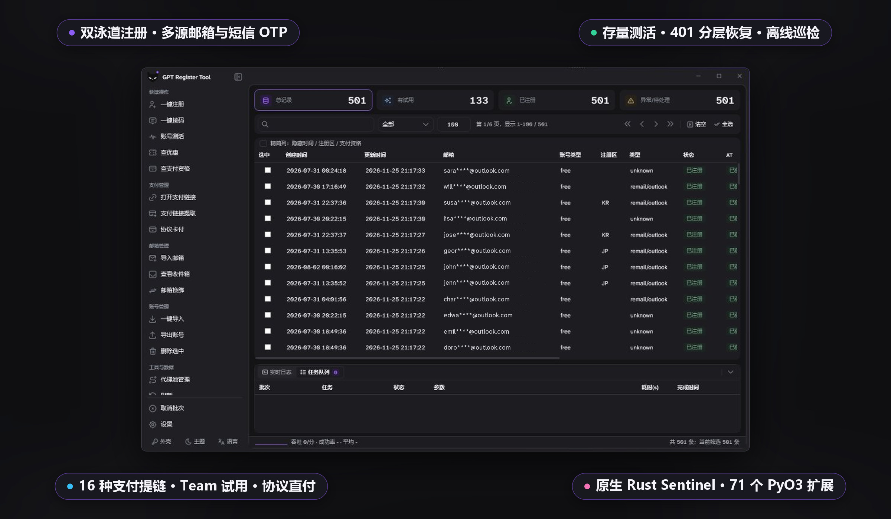
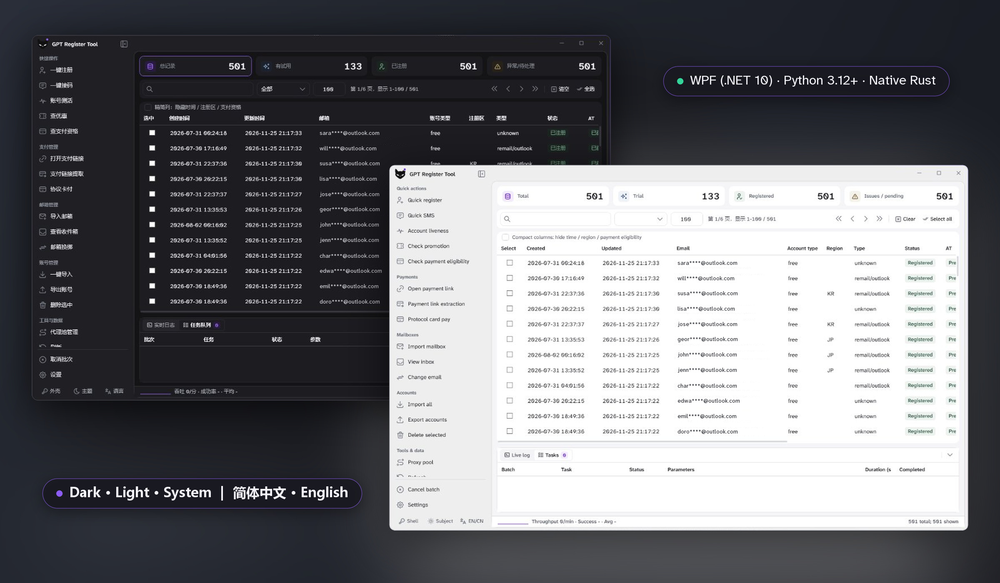
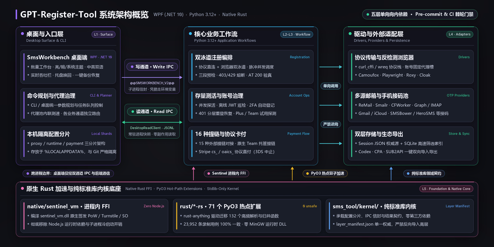

<div align="center">
  
  <h1>GPT-Register-Tool</h1>
  <p><strong>面向 Windows 的 ChatGPT 账号注册、邮箱 OTP、账号管理与支付链接提取工作台</strong><br>
  <em>A Windows desktop workbench for ChatGPT account registration, email OTP, account management, and payment-link extraction.</em></p>
  <p>
    <a href="./README.md">简体中文</a> · <a href="./README_EN.md">English</a>
  </p>

  [](https://github.com/2951461586/GPT-Register-Tool/actions/workflows/ci.yml)
  [](https://github.com/2951461586/GPT-Register-Tool/releases)
  [](./LICENSE)
  [](https://github.com/2951461586/GPT-Register-Tool/stargazers)
  [](https://github.com/2951461586/GPT-Register-Tool/releases)
  [](https://buymeatokens.com/2951461586?ref=badge-gpt-register-tool)

  <p>
    
    
    
    
  </p>
</div>

## 简介

**GPT-Register-Tool** 是一款基于 **WPF (.NET 10) + Python 3.12+ + 原生 Rust** 构建的 Windows 桌面工作台，聚焦 ChatGPT 账号全生命周期自动化与运维：

- **自动化注册与接码**：支持协议直连与多浏览器驱动双泳道注册、多供应商邮箱 OTP 与手机接码、断点续跑及 AT 200 验真。
- **账号与支付工作流**：内置账号测活、401 分层恢复、离线 JWT 巡检、Plus / GPT Team 5 席位试用检测、原生 Team 托管提链、协议绑卡支付与统一外部提链服务器对接，支持 Codex / CPA / SUB2API 导入导出。
- **高性能与本机隔离**：内置进程内 Rust Sentinel VM（零 Node.js 依赖）与 [71 个 PyO3 热点加速扩展](docs/current/rust-acceleration.md)；配置分片、Session 与运行数据默认存放在本机用户目录，不写入 Git。

当前发布说明：[release-v2026.11.28.md](docs/releases/release-v2026.11.28.md)

## 赞助商


[IPWO](https://www.ipwo.net)全球住宅代理为 ChatGPT 自动化工具提供全球住宅代理资源，支持多地区 IP 选择及灵活的代理配置。<br>
适用于注册代理、独立网络环境及自动化任务等场景，帮助开发者根据项目需求配置合适的网络出口。<br>
包含动态静态IP资源，支持免费测试。[IPWO测试入口](https://www.ipwo.net/?ref=githubGPT)


[ProxyLane](https://proxylane.dev/?utm_source=gpt-register-tool&utm_medium=partnership&utm_campaign=gpt-register-tool_sponsor_202610&utm_content=github_readme) 住宅代理覆盖 195 个国家，95%+ IP 获 Scamalytics 低风险评级，可按城市、ISP、ASN 定向。<br>
适合「账号 ↔ 代理槽绑定」：用户名后加会话名和城市，最长 72 小时同一个住宅 IP，换 IP 也留在同一城市。<br>
中文界面，支持 USDT 付款，首次购买使用优惠码 GPTREG30 享 7 折。

[](https://buymeatokens.com/2951461586?ref=badge)

## 界面概览

<div align="center">
  
  <br><br>
  
</div>

## 功能亮点

| 模块 | 核心能力 |
| --- | --- |
| **双泳道注册与接码** | 协议直连 + 多浏览器驱动（Playwright / Camoufox / Roxy / Cloak），接入 ReMail、Smailr、CFWorker、Graph/IMAP、Gmail、iCloud 邮箱池与 SMSBower / HeroSMS / Grizzly / NexSMS 手机接码；支持并发脉冲调度、断点续跑与 AT HTTP 200 验真 |
| **协议一致性与风控隔离** | 账号 ↔ 代理会话槽绑定，指纹语言与时区随出口 GeoIP 自动对齐；内置进程内 Sentinel Token 签发、网络三段预检与 403/429 熔断保护，避免无效消耗邮箱或 OTP |
| **存量测活与账号治理** | Session JSON + SQLite 双层索引；支持并发测活、离线 JWT 快速巡检（`--inspect-accounts`）、401 分层重登恢复、2FA 自动登记、Plus 与 GPT Team 5 席位试用资格探测，以及 Codex / CPA / SUB2API 一键导入导出 |
| **16 种提链与协议卡付** | 15 种 Plus 支付方式经 `sms_tool/pay_link/extract_server.py` 对接外部提链服务；原生内置 GPT Team 5 席位试用托管提链（`team_trial`）与非验证码 Stripe `cs_` / ChatGPT `oaics_` 协议直付引擎，遇 3DS 挑战自动中止并交还链接 |
| **原生 Rust 加速** | `native/sentinel_vm/` 编译为进程内 `sentinel_vm.dll` FFI，零 Node.js 运行时依赖；71 个 `rust-anything` PyO3 扩展加速 132 个热点函数，零 `unsafe`、零 MinGW 运行时 DLL，详见 [Rust 原生加速架构](docs/current/rust-acceleration.md) |
| **现代化桌面工作台** | 浅色 / 深色 / 跟随系统三态主题与中英双语切换；实时吞吐与失败分类状态栏、可折叠日志/队列底栏、代理池内联测速、关闭隐藏到托盘（`Ctrl+Alt+R` 唤回）及工作区配置/账号库一键备份恢复 |

## 架构简述

<div align="center">
  
</div>

- **五层单向依赖**：按「表面层 → CLI / 命令适配 → 应用工作流 → Provider / 驱动 / 持久化适配 → 标准库内核（`sms_tool/kernel/`）」分层，模块导入严格向内（以 `scripts/layer_manifest.json` 为单一权威）。
- **桌面读写双通道**：WPF 客户端通过 `PythonBackendClient` 子进程与版本化 `@@SMSWORKBENCH_V2@@` 信封执行写任务（代理凭据仅经环境变量传递，不进 `argv`），通过 `DesktopReadClient` 常驻 JSONL 通道无副作用读取快照。
- **Rust 原生底座与自动化门禁**：`native/sentinel_vm/` 提供进程内 Sentinel VM FFI，`rust/` 下 71 个由 `rust-anything` 管理的 PyO3 扩展加速 132 个热点函数（23,952 条录制用例 100% 一致，0 `unsafe`）；跨语言契约清单与分层棘轮由预提交钩子与 GitHub Actions CI 全程守卫。

详细设计见 [架构与边界说明](docs/architecture.md)、[桌面端 UI 架构](docs/current/ui-architecture.md)、[Rust 加速架构](docs/current/rust-acceleration.md) 与 [目录职责](docs/directory-map.md)。

## 常见问题

先在 [docs/current/faq.md](docs/current/faq.md) 找一遍，那里每条都有实测数据或上游契约作为依据：

- **新号没有 Plus 试用 / 优惠** —— 上游按来源放量，实测 10 个 iCloud 账号 `trial_eligible=0`，不是指纹可修项。
- **iCloud 收不到验证码** —— ReMail 旧域名 2026-11-16 作废（必须用 `remail.best`），且 iCloud 订单的 `serviceToken` 只在订单详情返回。
- **没有密码 / 找不到 2FA** —— 只有 password 模式设密码；2FA 默认登记，secret 在 `accounts.totp_secret`。
- **提链报 `unusual activity`** —— checkout 侧风控，换出口或冷却后重试。

## 部署方式

### 环境要求

- Windows 10/11 x64。
- Python 3.12 或更高版本（与 `scripts/runtime_manifest.json` 里打包的解释器一致；3.10/3.11 从未被任何门禁验证过）。
- `curl_cffi==0.17.0`。注册预检会校验安装版本（0.15–0.17）和 `chrome152` profile；旧版本不会进入邮箱采购或注册阶段。
- 可选第二传输后端 `wreq>=0.13.0,<0.14`（`PROTOCOL_HTTP_CLIENT=wreq` / `email_registration.protocol_http_backend`，默认 `curl_cffi`）；未安装或无法运行所选指纹时**直接失败**，不静默回退。
- .NET 10 Desktop Runtime；从源码编译时需要 .NET 10 SDK。
- **无需 Node.js**：Sentinel PoW / Turnstile / SO 签发已迁入内置原生 Rust FFI（`sms_tool/sentinel/runtime/sentinel_vm.dll`）；仅当你需要从源码重新编译 `native/sentinel_vm/` 或 `rust/*-rs/` 时才需要 Rust 工具链。
- **Playwright Chromium**（可选）：浏览器驱动注册及 PayPal 浏览器授权/验证码流程需要，执行 `python -m playwright install chromium`。
- 可正常访问目标邮箱、ChatGPT 和提链服务器的网络环境。
- 注册代理、浏览器注册代理、邮箱收件代理、支付资格专用代理和提链代理彼此独立；代理字段留空时不注入本机默认值，由 `proxy.lanes` / 旧键 / 预检决定。

安装依赖后，可运行环境预检确认原生 Sentinel FFI、Playwright Chromium 和关键 Python 包就绪：

```powershell
python scripts/preflight_env.py
```

### 方式一：安装包

从 GitHub Releases 下载最新的：

```text
GPT-Register-Tool-Setup-vYYYY.MM.DD.exe
```

运行安装器并选择安装目录。首次启动前仍需安装 Python 依赖，并创建本地配置：

```powershell
python -m pip install -r requirements.txt -c constraints.txt
python -m sms_tool --init-config
```

### 方式二：便携压缩包

下载并解压：

```text
GPT-Register-Tool-win-x64-vYYYY.MM.DD.zip
```

在解压目录执行：

```powershell
python -m pip install -r requirements.txt -c constraints.txt
python -m sms_tool --init-config
.\dist\net10\SmsWorkbench.exe
```

### 方式三：从源码运行

```powershell
git clone https://github.com/2951461586/GPT-Register-Tool.git
cd GPT-Register-Tool
python -m pip install -r requirements.txt -c constraints.txt
python -m sms_tool --init-config
powershell -ExecutionPolicy Bypass -File .\SmsWorkbench\build_dotnet.ps1
.\dist\net10\SmsWorkbench.exe
```

桌面程序只能通过 `SmsWorkbench/build_dotnet.ps1` 编译。不要直接运行 `dotnet build`，因为它只产生中间文件，不会更新标准工作区 `dist/net10`。

### 配置与凭证位置

配置分片（`proxy.json` / `runtime.json` / `payment.json`）和默认邮箱池 `mailbox_tokens.txt` 存放在**仓库之外**的用户目录：

```text
%LOCALAPPDATA%\GPTRegisterTool\config
```

设置环境变量 `GPT_REGISTER_CONFIG_DIR` 可改用其他目录（桌面端启动 Python 后端时会自动传递同一个值）。从旧版本升级时，仓库根目录里遗留的这些文件会在首次启动时**移动**（而不是复制）到新目录；目标目录已有同名文件时不会覆盖。`token_file` 配置为相对路径时，相对的是这个目录。

### 首次配置

打开桌面端的 **设置** 页面，至少完成以下配置：

1. 在 **网络与支付 → 基础网络** 中配置注册代理、浏览器注册代理、邮箱收件代理和支付资格专用代理；非空保存会写入对应的 `proxy.lanes.<lane>` 并同步旧键，留空不改动 lane。提链服务器地址、CDK 与可选代理池可在 **设置 → 提链服务器** 或「支付链接提取」窗口中保存。
2. 在 **邮箱与收信** 中配置 ReMail、CFWorker 或其他邮箱源。
3. 按需配置 SMSBower、CPA、SUB2API 和各协议支付参数。
4. 保存后重新打开对应功能即可使用新配置。

注册驱动在 **设置 -> 注册与接码 -> 注册驱动** 中选择，默认仍为 `protocol`。选择浏览器驱动后，注册会复用同一套邮箱 OTP、Session 提取、AT HTTP 200 探活和本地持久化边界：

- `playwright`：本机 Chromium，通过 Playwright 启动。
- `roxy`：连接本机 RoxyBrowser API 创建/打开 Profile，再通过 CDP 接管。
- `cloak`：调用已安装的 CloakBrowser Python SDK。
- `camoufox`：调用已安装的 Camoufox 反检测浏览器（**当前默认浏览器驱动**）。

RoxyBrowser 的 API/会话配置位于同一设置页的独立分区；CloakBrowser 的 License Key、持久化目录和指纹参数也在那里配置。未配置所选驱动的必需字段时，任务会返回脱敏的配置错误，不会回退到协议注册。浏览器驱动不绕过 CAPTCHA；遇到人工挑战会以 `manual_challenge_required` 结束，保留现有账号状态。

浏览器注册默认启用 **脉冲调度**（`registration.pulse`，波次间隔 + OTP-ban 暂停）与 **浏览器进程池**（`registration.browser_process_pool`，按进程复用浏览器上下文、按健康度回收）。二者与「账号 ↔ 代理槽绑定」协同：每个账号在整个生命周期内固定走同一个注册出口，重试时只刷新会话 sid，不切换代理成员——避免出口轮换被注册方判定为代理抖动而封禁。进程池哈希键按 `(driver, headless, timeout)` 缓存，使同一出口、同一头部配置的账号复用同一浏览器进程，降低冷启动开销。

ReMail API Key 也可以通过环境变量提供：

```powershell
$env:REMAIL_API_KEY = "rk-your-key"
```

环境变量优先于配置文件。桌面设置页保存的 API Key 仅写入上述用户配置目录，不在仓库内。

## 许可证与使用责任

本项目以 **MIT License** 发布，全文见 [LICENSE](LICENSE)。

界面图标取自 [tabler-icons](https://github.com/tabler/tabler-icons) v3.50.0（MIT License），
路径数据逐条照抄上游 outline SVG 并在 `SmsWorkbench/Themes/Glyphs.xaml` 标注来源图标名。

请仅在获得授权并符合相关服务条款、地区法规及组织政策的场景中使用本项目。使用者需要自行承担第三方邮箱、代理、接码与支付服务的费用、账号安全和数据合规责任；示例配置不包含任何真实凭据。
