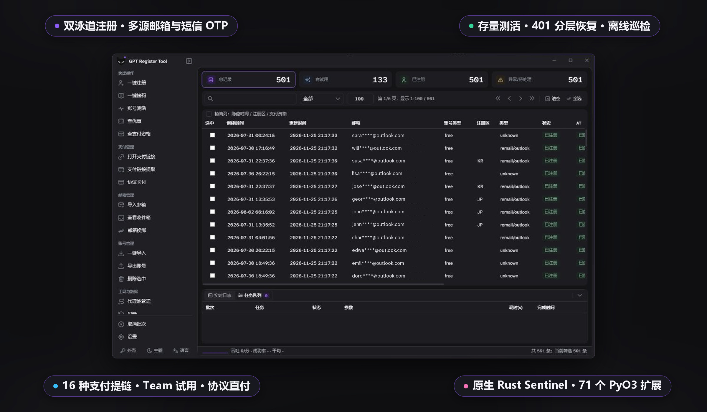
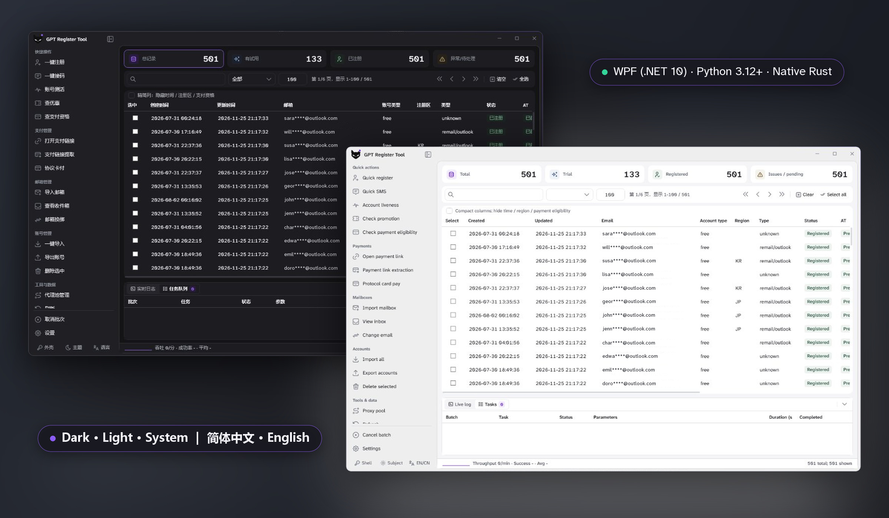

<div align="center">
  
  <h1>GPT-Register-Tool</h1>
  <p><strong>A Windows desktop workbench for ChatGPT account registration, email OTP, account management, and payment-link extraction</strong></p>
  <p>
    <a href="./README.md">简体中文</a> · <a href="./README_EN.md">English</a>
  </p>

  [](https://github.com/2951461586/GPT-Register-Tool/actions/workflows/ci.yml)
  [](https://github.com/2951461586/GPT-Register-Tool/releases)
  [](./LICENSE)
  [](https://github.com/2951461586/GPT-Register-Tool/stargazers)
  [](https://github.com/2951461586/GPT-Register-Tool/releases)
  [](https://buymeatokens.com/2951461586?ref=badge-gpt-register-tool)

  <p>
    
    
    
    
  </p>
</div>

## Introduction

**GPT-Register-Tool** is a Windows desktop workbench built on **WPF (.NET 10), Python 3.12+, and native Rust** for end-to-end ChatGPT account automation and operations:

- **Registration & OTP**: Dual-lane registration (built-in protocol + browser drivers), unified multi-provider email OTP and SMS verification, resumable checkpoints, and HTTP 200 AT verification.
- **Account & Payment Workflows**: Liveness probing, layered 401 recovery, offline JWT inspection, Plus & GPT Team 5-seat trial detection, native Team hosted checkout extraction, protocol card payment, unified external paylink-server integration, and Codex / CPA / SUB2API import-export.
- **Native Performance & Local-First Data**: In-process Rust Sentinel VM (zero Node.js dependency) paired with [71 PyO3 hot-path extensions](docs/current/rust-acceleration.md); sharded configs, sessions, and runtime state stay local and Git-ignored.

Current release notes: [v2026.11.28](./docs/releases/release-v2026.11.28.md)

## Sponsor


[IPWO](https://www.ipwo.net) provides global residential proxy resources for ChatGPT automation tools, with multi-region IP selection and flexible proxy configuration.<br>
It is suitable for registration proxies, isolated network environments, and automation tasks that require project-specific network exits.<br>
Dynamic and static IP resources are available with free testing through the [IPWO trial portal](https://www.ipwo.net/?ref=githubGPT).


[ProxyLane](https://proxylane.dev/?utm_source=gpt-register-tool&utm_medium=partnership&utm_campaign=gpt-register-tool_sponsor_202610&utm_content=github_readme) residential proxies cover 195 countries, with 95%+ of IPs rated low-risk by Scamalytics, and targeting by city, ISP, and ASN.<br>
Built for account ↔ proxy-slot binding: append a session name and city to the username to keep the same residential IP for up to 72 hours, and stay in the same city even when the IP rotates.<br>
Chinese interface, USDT payments supported, and 30% off your first purchase with code GPTREG30.

[](https://buymeatokens.com/2951461586?ref=badge)

## Interface Overview

<div align="center">
  
  <br><br>
  
</div>

## Highlights

| Area | Core Capabilities |
| --- | --- |
| **Dual-lane registration & OTP** | Built-in protocol lane + browser drivers (Playwright / Camoufox / Roxy / Cloak), unified ReMail / Smailr / CFWorker / Graph / IMAP / Gmail / iCloud mailbox pools, multi-vendor SMS (SMSBower / HeroSMS / Grizzly / NexSMS), pulse scheduling, checkpoint resume, and HTTP 200 AT verification |
| **Protocol consistency & isolation** | Per-account sticky proxy binding, GeoIP-aligned locale & timezone headers, in-process Sentinel token minting, three-hop network preflight, and 403/429 circuit protection before consuming mailboxes or OTPs |
| **Account health & governance** | Session JSON + SQLite dual index; concurrent liveness probing, offline JWT lightweight inspection (`--inspect-accounts`), layered 401 relogin recovery, auto 2FA enrollment, Plus & GPT Team 5-seat trial detection, and Codex / CPA / SUB2API import-export |
| **16 payment methods & card engine** | 15 Plus methods routed via `sms_tool/pay_link/extract_server.py` to an external Paylink Extraction Server, plus native in-process GPT Team 5-seat trial checkout (`team_trial`) and non-CAPTCHA Stripe `cs_` / ChatGPT `oaics_` protocol card payment (stopping safely on 3DS challenges) |
| **Native Rust acceleration** | `native/sentinel_vm/` compiles to an in-process `sentinel_vm.dll` FFI with **zero Node.js dependency**; 71 `rust-anything` PyO3 extensions accelerate 132 hot CPU functions with 0 `unsafe` and 0 MinGW runtime DLLs; see [Rust acceleration](docs/current/rust-acceleration.md) |
| **Modern desktop workbench** | Light / Dark / System theme modes and Chinese / English UI switching; live throughput & failure-class metrics bar, collapsible log/task drawer, inline proxy-pool speed testing, system tray & `Ctrl+Alt+R` hotkey, and one-click workspace backup/restore |

## Architecture Overview

- **Five inward-only layers**: Surface → CLI / Command Adapters → Application Workflows → Provider / Driver / Persistence Adapters → Stdlib-only Foundation Kernel (`sms_tool/kernel/`), governed by `scripts/layer_manifest.json`.
- **Dual read/write IPC**: `PythonBackendClient` runs write workflows over versioned `@@SMSWORKBENCH_V2@@` envelopes (passing proxy credentials via environment variables rather than `argv`), while `DesktopReadClient` queries a resident side-effect-free JSONL snapshot server.
- **Native Rust core & CI gates**: `native/sentinel_vm/` provides the in-process Sentinel VM FFI; 71 `rust-anything`-managed PyO3 crates under `rust/` accelerate 132 hot functions (23,952 recorded cases 100% matched, 0 `unsafe`), guarded end-to-end by pre-commit and GitHub Actions CI ratchets.

See [architecture and boundaries](docs/architecture.md), [desktop UI architecture](docs/current/ui-architecture.md), [Rust acceleration](docs/current/rust-acceleration.md), and [directory map](docs/directory-map.md).

## Installation

### Requirements

- Windows 10/11 x64.
- Python 3.12 or later (matches the interpreter pinned in `scripts/runtime_manifest.json`; 3.10/3.11 were never verified by any gate).
- .NET 10 Desktop Runtime; the .NET 10 SDK is required when building from source.
- **No Node.js required**: Sentinel runs in-process via the bundled Rust FFI library (`sms_tool/sentinel/runtime/sentinel_vm.dll`). A Rust toolchain is only needed if you rebuild `native/sentinel_vm/` or `rust/*-rs/` from source.
- Playwright Chromium (optional) for browser-assisted PayPal workflows and browser registration.

### Installation

Download the latest installer or portable archive from [GitHub Releases](https://github.com/2951461586/GPT-Register-Tool/releases), or build the desktop application from source:

```powershell
git clone https://github.com/2951461586/GPT-Register-Tool.git
cd GPT-Register-Tool
python -m pip install -r requirements.txt -c constraints.txt
python -m sms_tool --init-config
powershell -ExecutionPolicy Bypass -File .\SmsWorkbench\build_dotnet.ps1
.\dist\net10\SmsWorkbench.exe
```

The supported desktop build command is `SmsWorkbench/build_dotnet.ps1`. Its output is written to `dist/net10/SmsWorkbench.exe`.

### Configuration ownership

The active configuration lives in `proxy.json`, `runtime.json` and
`payment.json`. If any shard exists, only existing shards are merged, in that
order. Legacy `config.json` is used and migrated only when no shards exist.
Do not edit a legacy file expecting it to override active shards.

`config_schema.json` is a shared ownership manifest, not JSON Schema. Runtime
validation remains in Python config/driver preflight. Local configuration files
contain credentials and must stay ignored. See
[configuration ownership](docs/current/configuration.md).

Desktop icons come from [tabler-icons](https://github.com/tabler/tabler-icons) v3.50.0
(MIT License). The path data is copied verbatim from the upstream outline SVGs, and each
key in `SmsWorkbench/Themes/Glyphs.xaml` names the icon it came from.

## License And Responsible Use

Released under the **MIT License**; the full text is in [LICENSE](LICENSE).

Use this project only with authorization and in compliance with applicable service terms, regional laws, and organizational policies. You are responsible for third-party mailbox, proxy, SMS and payment costs, account security, and data compliance; the sample configuration contains no real credentials.
