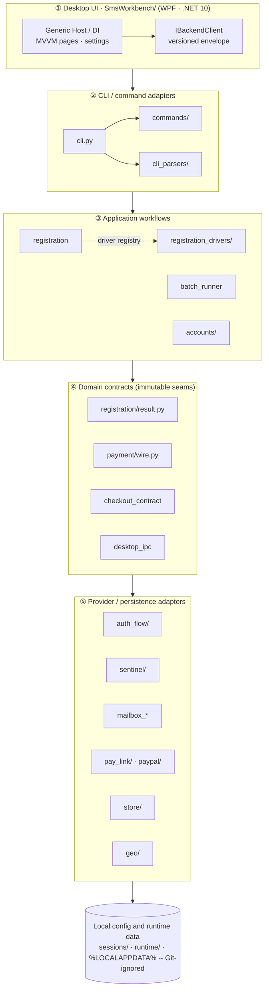

<div align="center">
  
  <h1>GPT-Register-Tool</h1>
  <p><strong>A Windows desktop workbench for ChatGPT account registration, email OTP, account management, and payment workflows</strong></p>
  <p>
    <a href="./README.md">简体中文</a> · <a href="./README_EN.md">English</a>
  </p>
  <p>
    
    
    
  </p>
</div>

## Introduction

GPT-Register-Tool combines a **WPF desktop client with a Python core** for email OTP registration, account and Session management, proxy configuration, payment-link extraction, and account export. Runtime data is stored locally by default and is not committed to Git.

Current release notes: [v2026.10.23](./docs/releases/release-v2026.10.23.md).


## Sponsor


[IPWO](https://www.ipwo.net) provides global residential proxy resources for ChatGPT automation tools, with multi-region IP selection and flexible proxy configuration.<br>
It is suitable for registration proxies, isolated network environments, and automation tasks that require project-specific network exits.<br>
Dynamic and static IP resources are available with free testing through the [IPWO trial portal](https://www.ipwo.net/?ref=githubGPT).


[ProxyLane](https://proxylane.dev/?utm_source=gpt-register-tool&utm_medium=partnership&utm_campaign=gpt-register-tool_sponsor_202610&utm_content=github_readme) residential proxies cover 195 countries, with 95%+ of IPs rated low-risk by Scamalytics, and targeting by city, ISP, and ASN.<br>
Built for account ↔ proxy-slot binding: append a session name and city to the username to keep the same residential IP for up to 72 hours, and stay in the same city even when the IP rotates.<br>
Chinese interface, USDT payments supported, and 30% off your first purchase with code GPTREG30.


## Highlights

| Area | Capability |
| --- | --- |
| **Registration** | Mailbox pools / ReMail long-lived mailboxes / CFWorker domains / iCloud relay links plus multi-vendor SMS; single and concurrent batches; each account mints its own Sentinel token and `oai-did`; success means the AT probe answered HTTP 200; registration only stores the AT/Session and never builds payment links |
| **Protocol consistency and recovery** | Preflight of the ChatGPT / Auth / Sentinel hops before a mailbox is spent; one proxy session per account, rotated only on failure; NextAuth / Auth / ChatGPT share a stable `oai-did`, UA and client hints with GeoIP-derived locale and timezone; 403/429 opens a circuit with no plain-HTTP PoW fallback; the checkpoint is persisted before the AT probe so a resume never re-spends an OTP |
| **Mailbox and OTP** | One mailbox seam: ReMail, Smailr, CFWorker, Microsoft Graph/OAuth, Outlook/Hotmail IMAP, Gmail, iCloud relay links and legacy pool formats; OTP parsing filters by subject, sender, exact recipient and server timestamp, then ranks candidates; ReMail adds adaptive polling, detail-body fetch and a 30s resend |
| **Protocol payment links** | 15 methods: PayPal, GoPay, GCash, GrabPay, UPI, iDEAL, PIX, Kakao Pay, BLIK, TWINT, direct card Checkout, MoMo, QRIS, Bizum, Naver Pay (the last three are CLI canaries); Checkout and Approve use separate exit pools and rewrite country and Session per method; Checkout / Promotion / PM / Confirm / Poll / Provider Redirect stay distinct stages; five terminal states with `retryable` and `error_stage`, and `unknown` must be reconciled first |
| **Batch payment** | JIT AT gate, layered HTTP 401 recovery (RT -> Cookie -> isolated browser mailbox OTP -> Codex OAuth), eligibility matrix, Canary pause, per-method concurrency, atomic checkpoints and explicit resume; the report separates AT 200, eligibility, visible payment methods, approve and final link/QR artifacts |
| **Accounts and data** | Session JSON plus SQLite dual index; liveness probe and 401 recovery; promotion and payment-eligibility badges (plan/trial only by default, an explicit entry point creates a one-shot Checkout to read payment-method evidence); Codex / CPA / SUB2API import-export; local data lives in `sessions/` and `runtime/`, both Git-ignored |
| **Desktop operations** | Selected accounts drive the "batch protocol payment" window (concurrency, retries, Canary, two exit pools, checkpoint resume); each `Saved session:` debounces an account-pool refresh; multi-select delete is one backend batch command |
| **SMS** | SMSBower, HeroSMS, Grizzly and NexSMS provider selection with online catalog lookup (availability depends on each vendor), plus send retry, timeout and poll-interval settings; see the [one-click SMS contract](docs/current/one-click-sms.md) |


### Architecture

Five layers — **① UI → ② CLI / command adapters → ③ application workflows → ④ domain contracts → ⑤ provider / persistence adapters**. Imports point inward only; a lower layer never imports a higher one. Configuration and runtime data live outside the repository (Git-ignored). Registration has two lanes — protocol (the built-in default) and browser drivers — sharing one mailbox-OTP, session-extraction and AT-probe boundary.



Module ownership and responsibility per layer:

| Layer | Modules | Responsibility |
| ---------------------------------------- | --- | --- |
| ① Desktop UI | `SmsWorkbench/` | Generic Host / DI, MVVM pages, settings, batch-payment window, account pool; calls the backend through `IBackendClient` with argument lists plus cancel / timeout / process-tree kill |
| ② CLI / command adapters | `cli.py`, `commands/`, `cli_parsers/` | Argument parsing, task orchestration, batches, exit status; owns no provider implementation |
| ③ Application workflows | `registration/orchestrator.py`, `registration/handlers.py` | Registration facade and protocol lane: stage order, Sentinel issuance, OTP, AT probe |
| ③ Application workflows | `batch_runner.py`, `registration/pulse.py` | Concurrency and pulse scheduling, JIT AT gate, atomic checkpoints and resume |
| ③ Application workflows | `registration_drivers/` | Browser drivers (playwright · camoufox · roxy · cloak) plus `browser_flow/` and `external_sessions/` |
| ③ Application workflows | `accounts/`, `codex_oauth.py` | Existing-account recovery and Codex OAuth; never new signup |
| ④ Domain contracts | `registration/result.py`, `registration/flags.py`, `checkout_contract.py`, `payment/wire.py`, `desktop_ipc.py` | Immutable seams bound once per invocation; `RegistrationOperations` is a fixed interface, not a live module passed into the workflow |
| ⑤ Provider / persistence adapters&nbsp;&nbsp;&nbsp;&nbsp;&nbsp;&nbsp;&nbsp;&nbsp;&nbsp;&nbsp;&nbsp;&nbsp;&nbsp;&nbsp; | `auth_flow/` | Step functions: signin / authorize / continue / OTP / TOTP |
| ⑤ Provider / persistence adapters&nbsp;&nbsp;&nbsp;&nbsp;&nbsp;&nbsp;&nbsp;&nbsp;&nbsp;&nbsp;&nbsp;&nbsp;&nbsp;&nbsp; | `sentinel/` | Sentinel token issuance (Node `sdk.js` runner) |
| ⑤ Provider / persistence adapters&nbsp;&nbsp;&nbsp;&nbsp;&nbsp;&nbsp;&nbsp;&nbsp;&nbsp;&nbsp;&nbsp;&nbsp;&nbsp;&nbsp; | `mailbox/service.py`, `mailbox/strategies.py`, `providers/` | Mailbox routing, capability resolution, polling policy, provider transport |
| ⑤ Provider / persistence adapters&nbsp;&nbsp;&nbsp;&nbsp;&nbsp;&nbsp;&nbsp;&nbsp;&nbsp;&nbsp;&nbsp;&nbsp;&nbsp;&nbsp; | `pay_link/`, `paypal/`, `paypal_link/`, `upi_link/` | Checkout contract, capability probe, wallets / GCash |
| ⑤ Provider / persistence adapters&nbsp;&nbsp;&nbsp;&nbsp;&nbsp;&nbsp;&nbsp;&nbsp;&nbsp;&nbsp;&nbsp;&nbsp;&nbsp;&nbsp; | `store/` | SQLite + Session JSON persistence and domain facts |
| ⑤ Provider / persistence adapters&nbsp;&nbsp;&nbsp;&nbsp;&nbsp;&nbsp;&nbsp;&nbsp;&nbsp;&nbsp;&nbsp;&nbsp;&nbsp;&nbsp; | `geo/`, `proxy/routing.py`, `fingerprint_pool.py` | Exit GeoIP and fingerprint binding |

`services/` holds optional local protocol services behind a subprocess boundary (`mail-otp-web` and `protocol-payment`); it is not one of the five layers.

See [architecture](docs/architecture.md) for boundaries and [directory map](docs/directory-map.md) for ownership.


## Installation

### Requirements

- Windows 10/11 x64.
- Python 3.10 or later.
- .NET 10 Desktop Runtime; the .NET 10 SDK is required when building from source.
- Node.js 18 or later available on `PATH`.
- Playwright Chromium for browser-assisted payment workflows and browser registration.

### Installation

Download the latest installer or portable archive from [GitHub Releases](https://github.com/2951461586/GPT-Register-Tool/releases), or build the desktop application from source:

```powershell
git clone https://github.com/2951461586/GPT-Register-Tool.git
cd GPT-Register-Tool
python -m pip install -r requirements.txt -c constraints.txt
python -m sms_tool --init-config
powershell -ExecutionPolicy Bypass -File .\SmsWorkbench\build_dotnet.ps1
.\dist\net10\SmsWorkbench.exe
```

The supported desktop build command is `SmsWorkbench/build_dotnet.ps1`. Its output is written to `dist/net10/SmsWorkbench.exe`.

### Configuration ownership

The active configuration lives in `proxy.json`, `runtime.json` and
`payment.json`. If any shard exists, only existing shards are merged, in that
order. Legacy `config.json` is used and migrated only when no shards exist.
Do not edit a legacy file expecting it to override active shards.

`config_schema.json` is a shared ownership manifest, not JSON Schema. Runtime
validation remains in Python config/driver preflight. Local configuration files
contain credentials and must stay ignored. See
[configuration ownership](docs/current/configuration.md).


## License And Responsible Use

Released under the **MIT License**; the full text is in [LICENSE](LICENSE).

Use this project only with authorization and in compliance with applicable service terms, regional laws, and organizational policies. You are responsible for third-party mailbox, proxy, SMS and payment costs, account security, and data compliance; the sample configuration contains no real credentials.
