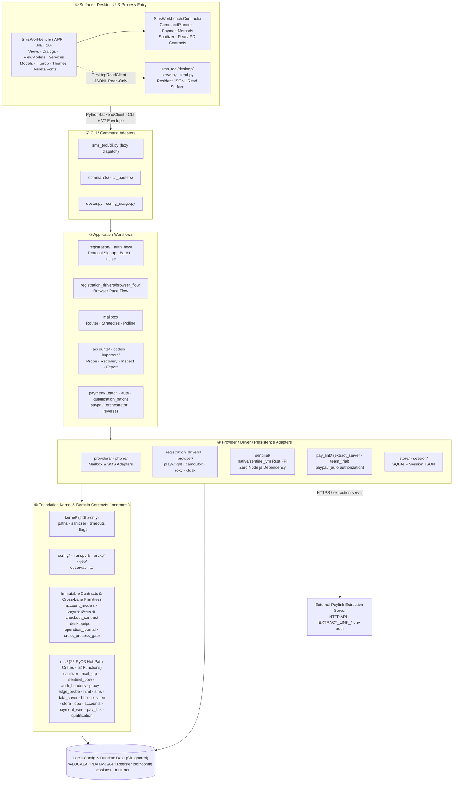

<div align="center">
  
  <h1>GPT-Register-Tool</h1>
  <p><strong>A Windows desktop workbench for ChatGPT account registration, email OTP, account management, and payment-link extraction</strong></p>
  <p>
    <a href="./README.md">简体中文</a> · <a href="./README_EN.md">English</a>
  </p>
  <p>
    <a href="https://github.com/2951461586/GPT-Register-Tool/actions/workflows/ci.yml"></a>
    <a href="https://github.com/2951461586/GPT-Register-Tool/releases"></a>
    <a href="./LICENSE"></a>
    <a href="https://github.com/2951461586/GPT-Register-Tool/stargazers"></a>
    <a href="https://github.com/2951461586/GPT-Register-Tool/releases"></a>
  </p>
  <p>
    
    
    
    
  </p>
</div>

## Introduction

GPT-Register-Tool combines a **WPF (.NET 10) desktop client, a Python 3.12+ core, and a native Rust acceleration layer** (`native/sentinel_vm/` in-process Rust Sentinel VM with **zero Node.js dependency**, plus 25 `rust-anything` PyO3 hot-path extensions covering redaction, OTP/SMS extraction, Sentinel SHA3-512 PoW solving, auth fingerprint header helpers, edge-probe challenge classification, payment wire & qualification state classification, pay-link contract normalization, proxy normalization/masking/retargeting/egress keys, HTML stripping, browser static-asset filtering, HTTP callback/cookie helpers, error & recovery classification, offline JWT decoding, CPA classification, and session conversion) for email OTP registration, account and Session management, Plus + GPT Team 5-seat trial promotion checks and native Team hosted checkout extraction, proxy governance, external paylink extraction server integration, and account export. Runtime data is stored locally by default and is not committed to Git.

Current release notes: [v2026.11.25](./docs/releases/release-v2026.11.25.md).


## Sponsor


[IPWO](https://www.ipwo.net) provides global residential proxy resources for ChatGPT automation tools, with multi-region IP selection and flexible proxy configuration.<br>
It is suitable for registration proxies, isolated network environments, and automation tasks that require project-specific network exits.<br>
Dynamic and static IP resources are available with free testing through the [IPWO trial portal](https://www.ipwo.net/?ref=githubGPT).


[ProxyLane](https://proxylane.dev/?utm_source=gpt-register-tool&utm_medium=partnership&utm_campaign=gpt-register-tool_sponsor_202610&utm_content=github_readme) residential proxies cover 195 countries, with 95%+ of IPs rated low-risk by Scamalytics, and targeting by city, ISP, and ASN.<br>
Built for account ↔ proxy-slot binding: append a session name and city to the username to keep the same residential IP for up to 72 hours, and stay in the same city even when the IP rotates.<br>
Chinese interface, USDT payments supported, and 30% off your first purchase with code GPTREG30.

### Support

[](https://buymeatokens.com/2951461586)

## Highlights

| Area | Capability |
| --- | --- |
| **Registration** | Mailbox pools / ReMail long-lived mailboxes / CFWorker domains / iCloud relay links plus multi-vendor SMS; single, concurrent, and target-success (`--target-success` + `--max-attempts`) batches; each account mints its own Sentinel token and `oai-did`; success means the AT probe answered HTTP 200; registration only stores the AT/Session and never builds payment links |
| **Protocol consistency and recovery** | Preflight of the ChatGPT / Auth / Sentinel hops before a mailbox is spent; one proxy session per account, rotated only on failure; NextAuth / Auth / ChatGPT share a stable `oai-did`, UA and client hints with GeoIP-derived locale and timezone; 403/429 opens a circuit with no plain-HTTP PoW fallback; the checkpoint is persisted before the AT probe so a resume never re-spends an OTP |
| **Mailbox and OTP** | One mailbox seam: ReMail, Smailr, CFWorker, Microsoft Graph/OAuth, Outlook/Hotmail IMAP, Gmail, iCloud relay links and legacy pool formats; OTP parsing filters by subject, sender, exact recipient and server timestamp, then ranks candidates; ReMail adds adaptive polling, detail-body fetch and a 30s resend |
| **Payment link extraction** | 16 catalog methods total: 15 Plus protocol methods (PayPal, GoPay, GCash, GrabPay, UPI, iDEAL, PIX, Kakao Pay, BLIK, TWINT, direct card Checkout, MoMo, QRIS, Bizum, Naver Pay) route through `sms_tool/pay_link/extract_server.py` to an external Paylink Extraction Server (CDK passes strictly via environment variables); plus a native in-process **GPT Team 5-seat trial hosted checkout extractor** (`team_trial`, `sms_tool/pay_link/team_trial.py` calling `POST /backend-api/payments/checkout` directly with zero external CDK, automatic billing-country alignment, and `--team-workspace-name` / `--team-seat-quantity` options); read-only capability & payment qualification probes remain in-tree with atomic checkpoint resume |
| **Native Rust acceleration** | `native/sentinel_vm/` compiles to an in-process `sentinel_vm.dll` FFI with **zero Node.js dependency**; 25 `rust-anything` PyO3 extensions accelerate 52 hot CPU functions (sanitizer 8.3×, OTP extraction 6.9× / up to 63×, Sentinel PoW 6.9×, error classification 6.2×, payment wire attestation/diagnostics 4.6× / up to 14.4×, HTML stripping 4.0×/3.5×/3.0×, proxy normalization/masking/retargeting 3.4× / up to 15×, auth fingerprint headers 2.8× / up to 8.9×, egress identity & recovery redaction 2.4×/2.3×, pay-link contract normalization 2.0×, edge-probe classification 1.3×), with 0 `unsafe` and 0 MinGW runtime DLLs; see [Rust acceleration](docs/current/rust-acceleration.md) |
| **Accounts and data** | Session JSON plus SQLite dual index; liveness probe, offline JWT lightweight inspection (`--inspect-accounts`) and upgraded 401 recovery (dedicated `relogin` proxy lane rotation, pre-OTP exit rotation, passwordless email-OTP fallback for legacy accounts, and transport-drop retry on post-relogin liveness verification); promotion badge probing and persisting machine-readable Plus trial and **GPT Team 5-seat trial (`team-1-month-free`)** flags; Codex / CPA / SUB2API import-export; local data lives in `sessions/` and `runtime/`, both Git-ignored |
| **Desktop operations** | Role-folder namespace isolation (`Models` / `Services` / `ViewModels` / `Views` / `Dialogs` / `Interop`) + window-independent Coordinators; selected accounts drive the "Payment link extraction" window (extraction server config, masked CDK, concurrency, retries, Canary, collapsible proxy pools, checkpoint resume); each `Saved session:` debounces an account-pool refresh; multi-select delete is one backend batch command; browser drivers support `--block-assets` traffic saving |
| **SMS** | SMSBower, HeroSMS, Grizzly and NexSMS provider selection with online catalog lookup (availability depends on each vendor), plus send retry, timeout and poll-interval settings; see the [one-click SMS contract](docs/current/one-click-sms.md) |


## Architecture

The codebase is organized into five inward-only layers — **① Surface → ② CLI / Command Adapters → ③ Application Workflows → ④ Provider / Driver / Persistence Adapters → ⑤ Foundation Kernel & Domain Contracts** (`scripts/layer_manifest.json` is the single authority). Module-scope imports point strictly inward (`source layer <= target layer`); a lower layer never imports a higher one, and the innermost `sms_tool/kernel/` imports only the Python standard library.

The WPF desktop client (.NET 10) and the Python core communicate across a **dual read/write channel**, validated on both sides against the repository's cross-language schema manifests (`config_schema.json`, `ipc_schema.json`, `result_schema.json`, `sensitive_policy.json`, `payment_methods.json`):

- **Write path (task execution)**: `PythonBackendClient` spawns `python -m sms_tool` subprocesses for registration, liveness/recovery, email change, and batch payment; proxy credentials pass via environment variables (never in `argv`), and stdout streams versioned `@@SMSWORKBENCH_V2@@` progress/result envelopes written solely by `sms_tool/desktop/ipc.py`.
- **Read path (read-only snapshots)**: `DesktopReadClient` talks to `sms_tool/desktop/serve.py` / `sms_tool/desktop/read.py` over a resident JSONL request-response channel (with one-shot fallback) for side-effect-free account pool, mailbox pool, and SMS catalog reads.

Registration has two lanes — **protocol** (built-in default) and **browser drivers** — sharing one mailbox-OTP, session-extraction, and AT HTTP 200 probe boundary. Sharded configs and runtime data stay outside the repository (Git-ignored).



Module ownership and responsibility per layer:

| Layer | Modules | Responsibility |
| --- | --- | --- |
| ① Surface (Desktop UI) | `SmsWorkbench/` (`Views` · `Dialogs` · `ViewModels` · `Services` · `Models` · `Interop` · `Localization` · `Themes` · `Assets/Fonts/`) | Generic Host / DI, role-folder namespace isolation, MVVM shell & XAML dialogs, window-independent Coordinators, framed chrome/canvas Light & Dark themes with embedded `Atkinson Hyperlegible Next` typography, collapsible log/queue drawer, tray & global hotkey, workspace backup/restore |
| ① Surface (Contracts & Read Channel) | `SmsWorkbench.Contracts/`, `sms_tool/desktop/serve.py`, `sms_tool/desktop/read.py` | Window-independent CLI planning (`BackendCommandPlanner`), payment method catalog, log redaction, resident JSONL read-only snapshot server and `DesktopReadClient` wire contracts |
| ② CLI / Command Adapters | `sms_tool/cli.py`, `sms_tool/commands/`, `sms_tool/cli_parsers/`, `sms_tool/doctor.py`, `sms_tool/config_usage.py` | Lazy command dispatch, declaration-only parser groups, exit-code translation and environment diagnostics; owns no provider wire logic or direct DB writes |
| ③ Application Workflows (Registration & Auth) | `sms_tool/registration/` (`orchestrator.py` · `handlers.py` · `batch_runner.py` · `pulse.py`), `sms_tool/auth_flow/`, `sms_tool/registration_drivers/browser_flow/` | Entry dispatch with immutable `RegistrationOperations` binding, protocol stage ordering, target-success & pulse scheduling, resumable checkpoints, browser page state machine; protocol and browser lanes share one OTP / Session / AT 200 boundary |
| ③ Application Workflows (Mailbox · Accounts · Payment) | `sms_tool/mailbox/`, `sms_tool/accounts/`, `sms_tool/codex/`, `sms_tool/importers/`, `sms_tool/payment/batch.py`, `sms_tool/payment/qualification_batch.py` | Mailbox routing/strategies/polling, existing-account liveness / layered 401 recovery / offline JWT inspection (`sms_tool/accounts/account_inspection.py`) / promotion & health batches / email change / terminal cleanup, Codex OAuth & CPA/SUB2API import-export, batch payment & qualification orchestration |
| ④ Provider & Driver Adapters | `sms_tool/providers/`, `sms_tool/phone/`, `sms_tool/registration_drivers/`, `sms_tool/browser/`, `sms_tool/sentinel/`, `sms_tool/registration/sentinel_tokens.py` | Mailbox & SMS vendor clients and phone-slot reuse; browser drivers (playwright · camoufox · roxy · cloak), static-asset blocking (`sms_tool/registration_drivers/data_saver.py`), process/fingerprint pools; in-process native Rust Sentinel FFI (`sms_tool/sentinel/native_ffi.py`) issuance |
| ④ Payment Lanes & Persistence | `sms_tool/pay_link/`, `sms_tool/paypal/`, `sms_tool/store/`, `sms_tool/session/` | Multi-method registry & unified external Paylink Extraction Server HTTP adapter (`sms_tool/pay_link/extract_server.py`, serving all 15 catalog methods), PayPal authorization execution; SQLite + Session JSON dual-index persistence (`sms_tool/storage.py` back-compat shell) and canonical session building/refresh |
| ⑤ Foundation Kernel | `sms_tool/kernel/` | Zero-application-dependency stdlib-only core: paths, sanitizer, timeout constants, frozen-config boolean flags, failure vocabulary, error classification and shared transport helpers |
| ⑤ Infrastructure Primitives | `sms_tool/config/`, `sms_tool/transport/`, `sms_tool/proxy/`, `sms_tool/geo/`, `sms_tool/observability/` | Sharded config loading & read-only freezing; `curl_cffi` / `wreq` dual transport backends, single endpoint authority (`sms_tool/transport/endpoints.py`) and fingerprint pool; single proxy parser authority (`sms_tool/proxy/entry.py`), lane routing, health and two-hop local bridge (`sms_tool/proxy/bridge.py`); single exit GeoIP/timezone authority and sanitized telemetry |
| ⑤ Domain Contracts & Shared Seams | `sms_tool/accounts/account_models.py`, `sms_tool/payment/wire.py`, `sms_tool/payment/checkout_contract.py`, `sms_tool/payment/catalog.py`, `sms_tool/desktop/ipc.py`, `sms_tool/operation_journal.py`, `sms_tool/cross_process_gate.py` | Immutable cross-lane seams: typed account models, Checkout & payment wire kernel, method catalog, promotion/qualification states, sole `@@SMSWORKBENCH_V2@@` IPC writer, durable idempotency journal and cross-process file locks |

- **External extraction server boundary**: Legacy in-repo protocol-payment extractors have been retired; all 15 catalog payment methods route through `sms_tool/pay_link/extract_server.py` (`protocol_payments.extract_link_server` / `EXTRACT_LINK_*` env vars).
- **Native Rust acceleration & zero Node.js**: `native/sentinel_vm/` provides the in-process Sentinel VM FFI; 25 `rust-anything`-managed PyO3 crates under `rust/` accelerate 52 hot functions (6,712 recorded cases 100% matched, 0 `unsafe`; see [Rust acceleration](docs/current/rust-acceleration.md)).
- **Enforced architecture gates**: Layer direction and namespace isolation are checked automatically in CI and pre-commit by `scripts/import_layer_ratchet.py`, `scripts/kernel_boundary_ratchet.py`, `scripts/root_module_ratchet.py`, `scripts/architecture_scan.py`, and `tests/SmsWorkbench.Tests/NamespaceArchitectureTests.cs`.

See [architecture and boundaries](docs/architecture.md), [desktop UI architecture](docs/current/ui-architecture.md), [Rust acceleration](docs/current/rust-acceleration.md), and [directory map](docs/directory-map.md).


## Installation

### Requirements

- Windows 10/11 x64.
- Python 3.12 or later (matches the interpreter pinned in `scripts/runtime_manifest.json`; 3.10/3.11 were never verified by any gate).
- .NET 10 Desktop Runtime; the .NET 10 SDK is required when building from source.
- **No Node.js required**: Sentinel runs in-process via the bundled Rust FFI library (`sms_tool/sentinel/runtime/sentinel_vm.dll`). A Rust toolchain is only needed if you rebuild `native/sentinel_vm/` or `rust/*-rs/` from source.
- Playwright Chromium (optional) for browser-assisted PayPal workflows and browser registration.

### Installation

Download the latest installer or portable archive from [GitHub Releases](https://github.com/2951461586/GPT-Register-Tool/releases), or build the desktop application from source:

```powershell
git clone https://github.com/2951461586/GPT-Register-Tool.git
cd GPT-Register-Tool
python -m pip install -r requirements.txt -c constraints.txt
python -m sms_tool --init-config
powershell -ExecutionPolicy Bypass -File .\SmsWorkbench\build_dotnet.ps1
.\dist\net10\SmsWorkbench.exe
```

The supported desktop build command is `SmsWorkbench/build_dotnet.ps1`. Its output is written to `dist/net10/SmsWorkbench.exe`.

### Configuration ownership

The active configuration lives in `proxy.json`, `runtime.json` and
`payment.json`. If any shard exists, only existing shards are merged, in that
order. Legacy `config.json` is used and migrated only when no shards exist.
Do not edit a legacy file expecting it to override active shards.

`config_schema.json` is a shared ownership manifest, not JSON Schema. Runtime
validation remains in Python config/driver preflight. Local configuration files
contain credentials and must stay ignored. See
[configuration ownership](docs/current/configuration.md).


Desktop icons come from [tabler-icons](https://github.com/tabler/tabler-icons) v3.50.0
(MIT License). The path data is copied verbatim from the upstream outline SVGs, and each
key in `SmsWorkbench/Themes/Glyphs.xaml` names the icon it came from.

## License And Responsible Use

Released under the **MIT License**; the full text is in [LICENSE](LICENSE).

Use this project only with authorization and in compliance with applicable service terms, regional laws, and organizational policies. You are responsible for third-party mailbox, proxy, SMS and payment costs, account security, and data compliance; the sample configuration contains no real credentials.
