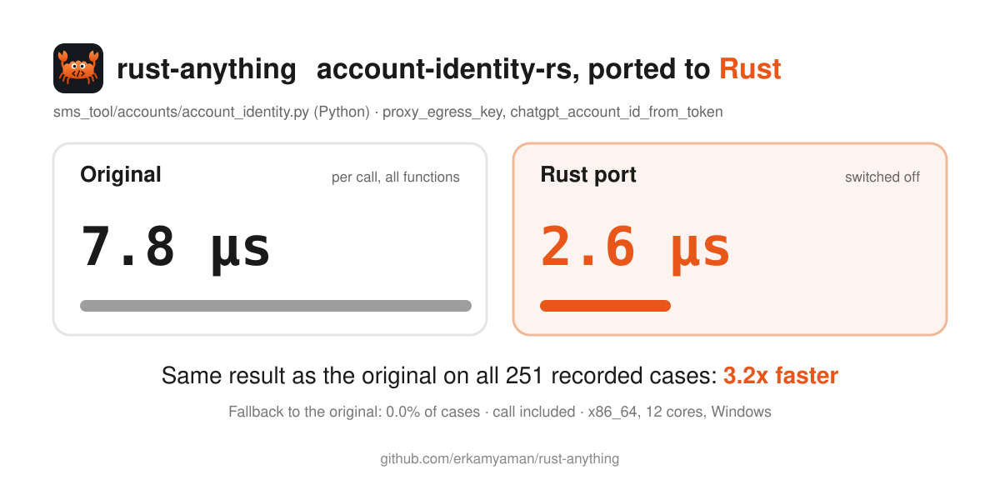

## `account-identity-rs` in Rust

| | |
| --- | --- |
| Unit | `sms_tool/accounts/account_identity.py` (Python) |
| Recorded cases matched | 251 / 251 |
| Speedup, call included | 3.2x (geometric mean) |
| Fallback to the original | 0.0% (0 of 251 cases) |
| Switched on | off |

| Function | Cases | Original per call | Rust per call | Speedup |
| --- | ---: | ---: | ---: | ---: |
| `proxy_egress_key` | 18 | 6.6 µs | 2.2 µs | 2.9x |
| `chatgpt_account_id_from_token` | 233 | 1.3 µs | 366 ns | 3.4x |

Measured with `rust-anything report` on x86_64, 12 cores, Windows: `diff` replays every recorded case, `bench` times them on both sides as callers call them. Reproduce: `rust-anything diff` and `rust-anything bench` in the crate folder.
