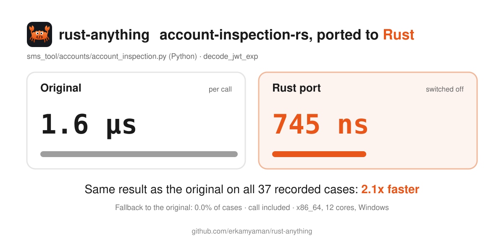

## `account-inspection-rs` in Rust

| | |
| --- | --- |
| Unit | `sms_tool/accounts/account_inspection.py` (Python) |
| Recorded cases matched | 37 / 37 |
| Speedup, call included | 2.1x (geometric mean) |
| Fallback to the original | 0.0% (0 of 37 cases) |
| Switched on | off |

| Function | Cases | Original per call | Rust per call | Speedup |
| --- | ---: | ---: | ---: | ---: |
| `decode_jwt_exp` | 37 | 1.6 µs | 745 ns | 2.1x |

Measured with `rust-anything report` on x86_64, 12 cores, Windows: `diff` replays every recorded case, `bench` times them on both sides as callers call them. Reproduce: `rust-anything diff` and `rust-anything bench` in the crate folder.
