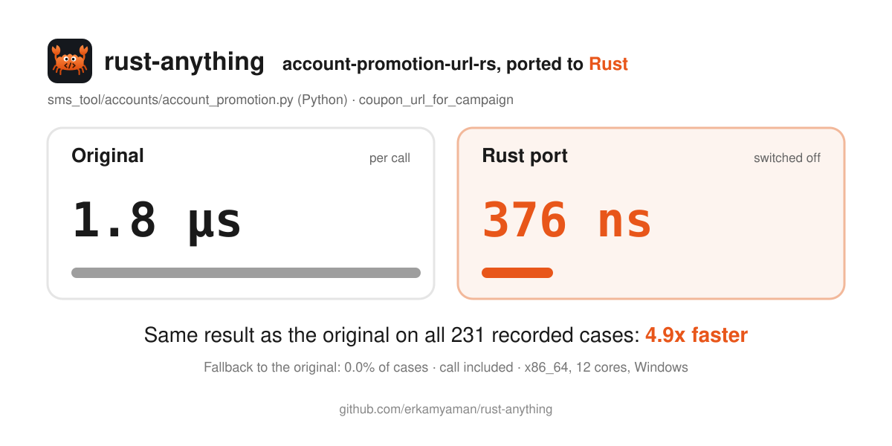

## `account-promotion-url-rs` in Rust

| | |
| --- | --- |
| Unit | `sms_tool/accounts/account_promotion.py` (Python) |
| Recorded cases matched | 231 / 231 |
| Speedup, call included | 4.9x (geometric mean) |
| Fallback to the original | 0.0% (0 of 231 cases) |
| Switched on | off |

| Function | Cases | Original per call | Rust per call | Speedup |
| --- | ---: | ---: | ---: | ---: |
| `coupon_url_for_campaign` | 231 | 1.8 µs | 376 ns | 4.9x |

Measured with `rust-anything report` on x86_64, 12 cores, Windows: `diff` replays every recorded case, `bench` times them on both sides as callers call them. Reproduce: `rust-anything diff` and `rust-anything bench` in the crate folder.
