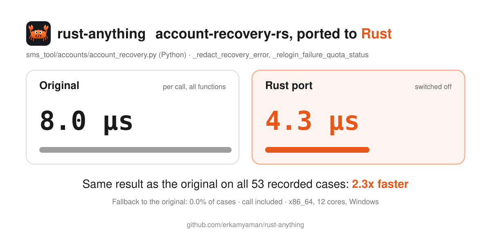

## `account-recovery-rs` in Rust

| | |
| --- | --- |
| Unit | `sms_tool/accounts/account_recovery.py` (Python) |
| Recorded cases matched | 53 / 53 |
| Speedup, call included | 2.3x (geometric mean) |
| Fallback to the original | 0.0% (0 of 53 cases) |
| Switched on | off |

| Function | Cases | Original per call | Rust per call | Speedup |
| --- | ---: | ---: | ---: | ---: |
| `_redact_recovery_error` | 34 | 3.7 µs | 912 ns | 4.1x |
| `_relogin_failure_quota_status` | 19 | 4.2 µs | 3.4 µs | 1.2x |

Measured with `rust-anything report` on x86_64, 12 cores, Windows: `diff` replays every recorded case, `bench` times them on both sides as callers call them. Reproduce: `rust-anything diff` and `rust-anything bench` in the crate folder.
