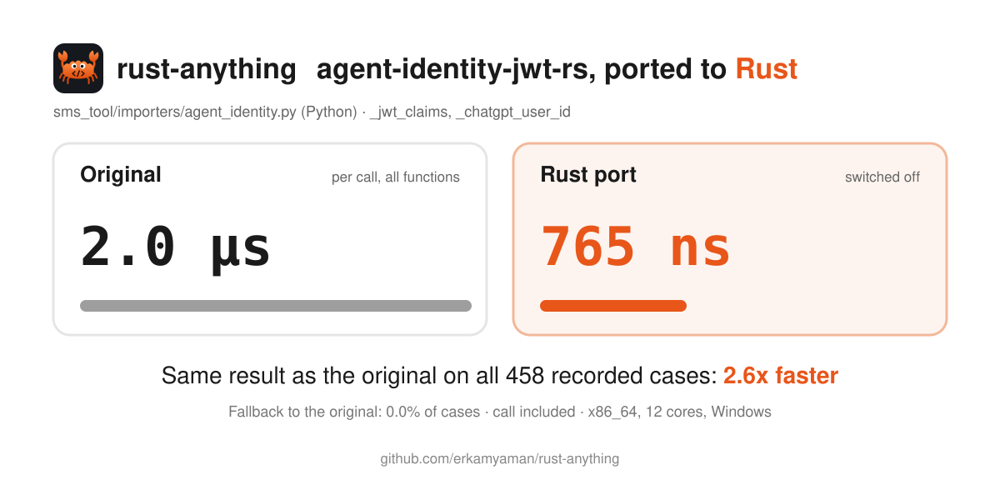

## `agent-identity-jwt-rs` in Rust

| | |
| --- | --- |
| Unit | `sms_tool/importers/agent_identity.py` (Python) |
| Recorded cases matched | 458 / 458 |
| Speedup, call included | 2.6x (geometric mean) |
| Fallback to the original | 0.0% (0 of 458 cases) |
| Switched on | off |

| Function | Cases | Original per call | Rust per call | Speedup |
| --- | ---: | ---: | ---: | ---: |
| `_jwt_claims` | 229 | 876 ns | 357 ns | 2.5x |
| `_chatgpt_user_id` | 229 | 1.2 µs | 407 ns | 2.9x |

Measured with `rust-anything report` on x86_64, 12 cores, Windows: `diff` replays every recorded case, `bench` times them on both sides as callers call them. Reproduce: `rust-anything diff` and `rust-anything bench` in the crate folder.
