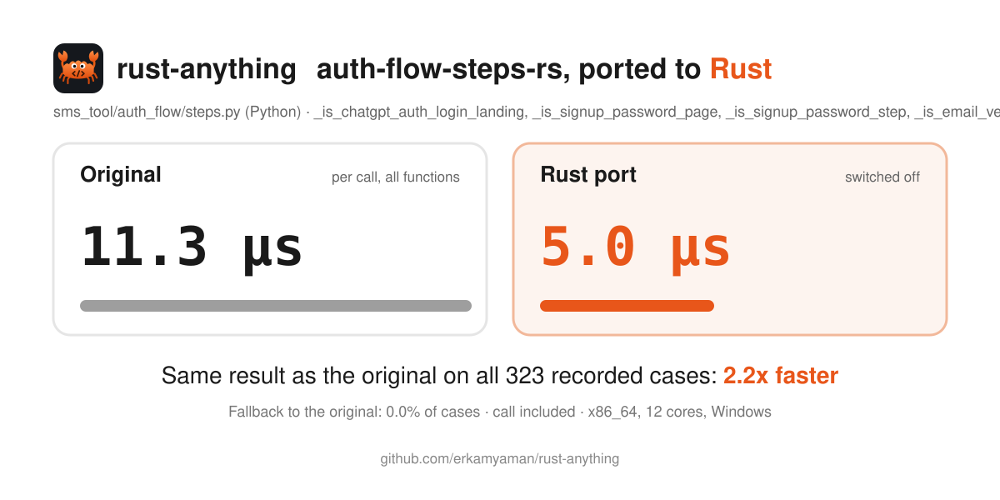

## `auth-flow-steps-rs` in Rust

| | |
| --- | --- |
| Unit | `sms_tool/auth_flow/steps.py` (Python) |
| Recorded cases matched | 323 / 323 |
| Speedup, call included | 2.2x (geometric mean) |
| Fallback to the original | 0.0% (0 of 323 cases) |
| Switched on | off |

| Function | Cases | Original per call | Rust per call | Speedup |
| --- | ---: | ---: | ---: | ---: |
| `_is_chatgpt_auth_login_landing` | 38 | 1.5 µs | 725 ns | 2.1x |
| `_is_signup_password_page` | 38 | 1.5 µs | 732 ns | 2.0x |
| `_is_signup_password_step` | 38 | 1.5 µs | 681 ns | 2.2x |
| `_is_email_verification_step` | 38 | 1.4 µs | 668 ns | 2.0x |
| `so_token_flow` | 26 | 2.7 µs | 1.0 µs | 2.7x |
| `same_flow_so_token` | 145 | 2.8 µs | 1.2 µs | 2.3x |

Measured with `rust-anything report` on x86_64, 12 cores, Windows: `diff` replays every recorded case, `bench` times them on both sides as callers call them. Reproduce: `rust-anything diff` and `rust-anything bench` in the crate folder.
