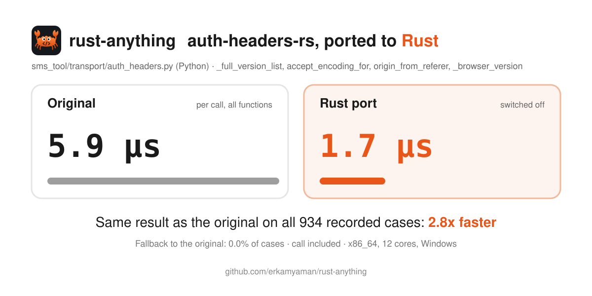

## `auth-headers-rs` in Rust

| | |
| --- | --- |
| Unit | `sms_tool/transport/auth_headers.py` (Python) |
| Recorded cases matched | 934 / 934 |
| Speedup, call included | 2.8x (geometric mean) |
| Fallback to the original | 0.0% (0 of 934 cases) |
| Switched on | off |

| Function | Cases | Original per call | Rust per call | Speedup |
| --- | ---: | ---: | ---: | ---: |
| `_full_version_list` | 254 | 488 ns | 370 ns | 1.3x |
| `accept_encoding_for` | 236 | 1.9 µs | 565 ns | 3.4x |
| `origin_from_referer` | 207 | 2.8 µs | 317 ns | 8.9x |
| `_browser_version` | 237 | 659 ns | 407 ns | 1.6x |

Measured with `rust-anything report` on x86_64, 12 cores, Windows: `diff` replays every recorded case, `bench` times them on both sides as callers call them. Reproduce: `rust-anything diff` and `rust-anything bench` in the crate folder.
