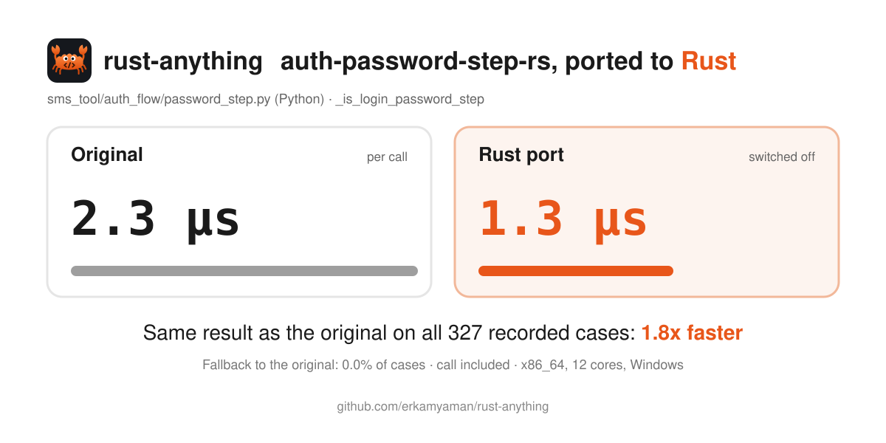

## `auth-password-step-rs` in Rust

| | |
| --- | --- |
| Unit | `sms_tool/auth_flow/password_step.py` (Python) |
| Recorded cases matched | 327 / 327 |
| Speedup, call included | 1.8x (geometric mean) |
| Fallback to the original | 0.0% (0 of 327 cases) |
| Switched on | off |

| Function | Cases | Original per call | Rust per call | Speedup |
| --- | ---: | ---: | ---: | ---: |
| `_is_login_password_step` | 327 | 2.3 µs | 1.3 µs | 1.8x |

Measured with `rust-anything report` on x86_64, 12 cores, Windows: `diff` replays every recorded case, `bench` times them on both sides as callers call them. Reproduce: `rust-anything diff` and `rust-anything bench` in the crate folder.
