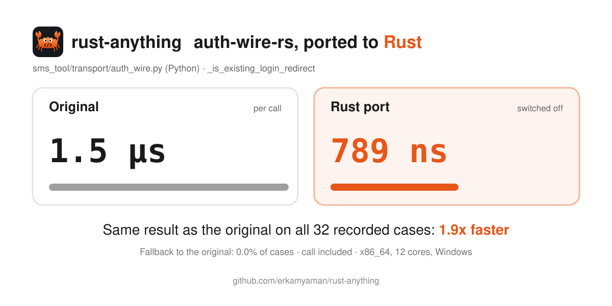

## `auth-wire-rs` in Rust

| | |
| --- | --- |
| Unit | `sms_tool/transport/auth_wire.py` (Python) |
| Recorded cases matched | 32 / 32 |
| Speedup, call included | 1.9x (geometric mean) |
| Fallback to the original | 0.0% (0 of 32 cases) |
| Switched on | off |

| Function | Cases | Original per call | Rust per call | Speedup |
| --- | ---: | ---: | ---: | ---: |
| `_is_existing_login_redirect` | 32 | 1.5 µs | 789 ns | 1.9x |

Measured with `rust-anything report` on x86_64, 12 cores, Windows: `diff` replays every recorded case, `bench` times them on both sides as callers call them. Reproduce: `rust-anything diff` and `rust-anything bench` in the crate folder.
