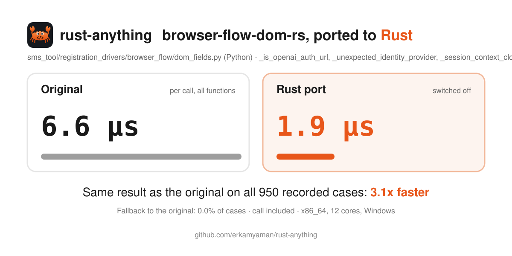

## `browser-flow-dom-rs` in Rust

| | |
| --- | --- |
| Unit | `sms_tool/registration_drivers/browser_flow/dom_fields.py` (Python) |
| Recorded cases matched | 950 / 950 |
| Speedup, call included | 3.1x (geometric mean) |
| Fallback to the original | 0.0% (0 of 950 cases) |
| Switched on | off |

| Function | Cases | Original per call | Rust per call | Speedup |
| --- | ---: | ---: | ---: | ---: |
| `_is_openai_auth_url` | 239 | 2.7 µs | 535 ns | 5.0x |
| `_unexpected_identity_provider` | 239 | 2.1 µs | 490 ns | 4.3x |
| `_session_context_closed` | 226 | 951 ns | 441 ns | 2.2x |
| `_terminal_session_error` | 246 | 889 ns | 444 ns | 2.0x |

Measured with `rust-anything report` on x86_64, 12 cores, Windows: `diff` replays every recorded case, `bench` times them on both sides as callers call them. Reproduce: `rust-anything diff` and `rust-anything bench` in the crate folder.
