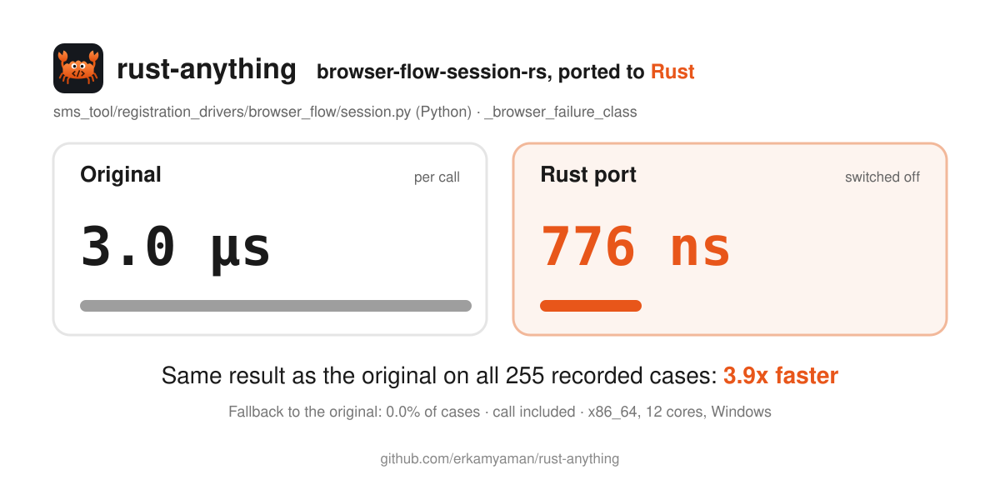

## `browser-flow-session-rs` in Rust

| | |
| --- | --- |
| Unit | `sms_tool/registration_drivers/browser_flow/session.py` (Python) |
| Recorded cases matched | 255 / 255 |
| Speedup, call included | 3.9x (geometric mean) |
| Fallback to the original | 0.0% (0 of 255 cases) |
| Switched on | off |

| Function | Cases | Original per call | Rust per call | Speedup |
| --- | ---: | ---: | ---: | ---: |
| `_browser_failure_class` | 255 | 3.0 µs | 776 ns | 3.9x |

Measured with `rust-anything report` on x86_64, 12 cores, Windows: `diff` replays every recorded case, `bench` times them on both sides as callers call them. Reproduce: `rust-anything diff` and `rust-anything bench` in the crate folder.
