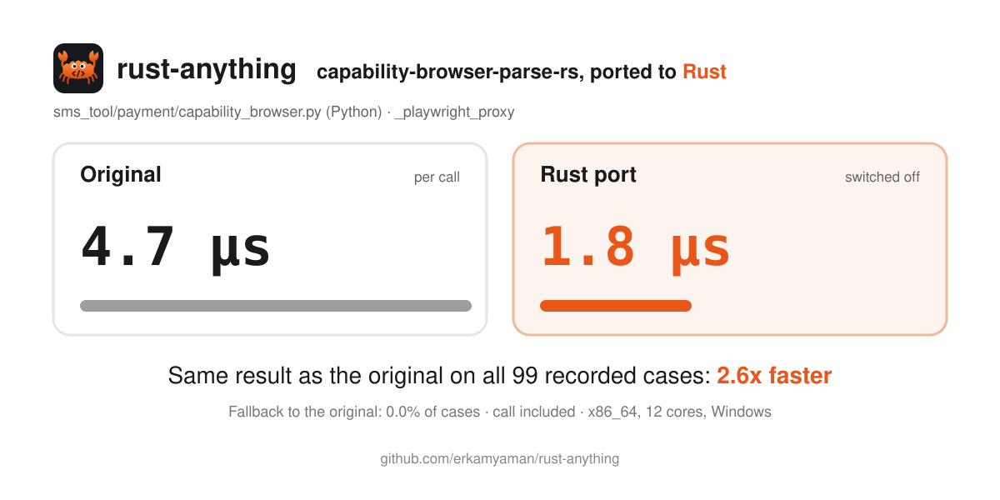

## `capability-browser-parse-rs` in Rust

| | |
| --- | --- |
| Unit | `sms_tool/payment/capability_browser.py` (Python) |
| Recorded cases matched | 99 / 99 |
| Speedup, call included | 2.6x (geometric mean) |
| Fallback to the original | 0.0% (0 of 99 cases) |
| Switched on | off |

| Function | Cases | Original per call | Rust per call | Speedup |
| --- | ---: | ---: | ---: | ---: |
| `_playwright_proxy` | 99 | 4.7 µs | 1.8 µs | 2.6x |

Measured with `rust-anything report` on x86_64, 12 cores, Windows: `diff` replays every recorded case, `bench` times them on both sides as callers call them. Reproduce: `rust-anything diff` and `rust-anything bench` in the crate folder.
