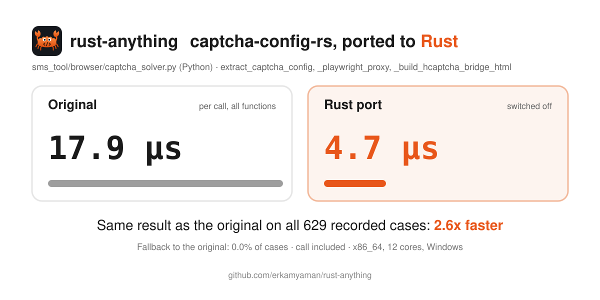

## `captcha-config-rs` in Rust

| | |
| --- | --- |
| Unit | `sms_tool/browser/captcha_solver.py` (Python) |
| Recorded cases matched | 629 / 629 |
| Speedup, call included | 2.6x (geometric mean) |
| Fallback to the original | 0.0% (0 of 629 cases) |
| Switched on | off |

| Function | Cases | Original per call | Rust per call | Speedup |
| --- | ---: | ---: | ---: | ---: |
| `extract_captcha_config` | 231 | 2.5 µs | 1.2 µs | 2.1x |
| `_playwright_proxy` | 21 | 1.5 µs | 1.1 µs | 1.4x |
| `_build_hcaptcha_bridge_html` | 377 | 13.9 µs | 2.4 µs | 5.7x |

Measured with `rust-anything report` on x86_64, 12 cores, Windows: `diff` replays every recorded case, `bench` times them on both sides as callers call them. Reproduce: `rust-anything diff` and `rust-anything bench` in the crate folder.
