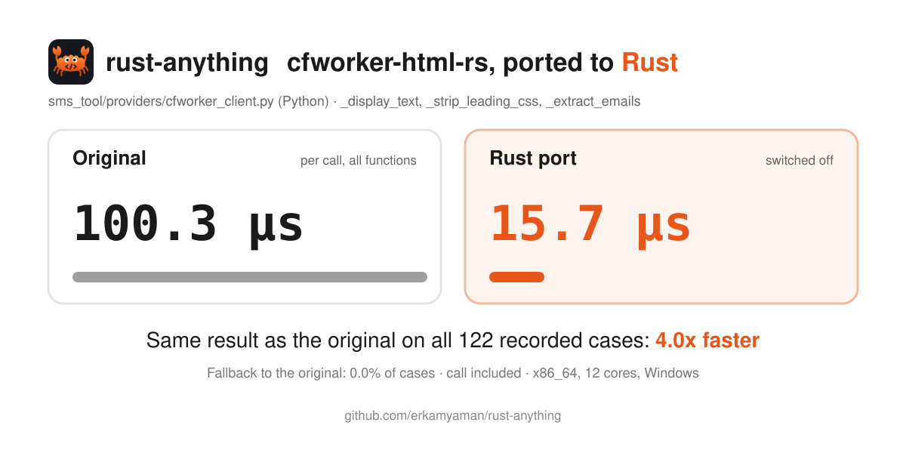

## `cfworker-html-rs` in Rust

| | |
| --- | --- |
| Unit | `sms_tool/providers/cfworker_client.py` (Python) |
| Recorded cases matched | 122 / 122 |
| Speedup, call included | 4.0x (geometric mean) |
| Fallback to the original | 0.0% (0 of 122 cases) |
| Switched on | off |

| Function | Cases | Original per call | Rust per call | Speedup |
| --- | ---: | ---: | ---: | ---: |
| `_display_text` | 41 | 88.8 µs | 10.0 µs | 8.9x |
| `_strip_leading_css` | 30 | 3.5 µs | 797 ns | 4.3x |
| `_extract_emails` | 51 | 8.1 µs | 4.8 µs | 1.7x |

Measured with `rust-anything report` on x86_64, 12 cores, Windows: `diff` replays every recorded case, `bench` times them on both sides as callers call them. Reproduce: `rust-anything diff` and `rust-anything bench` in the crate folder.
