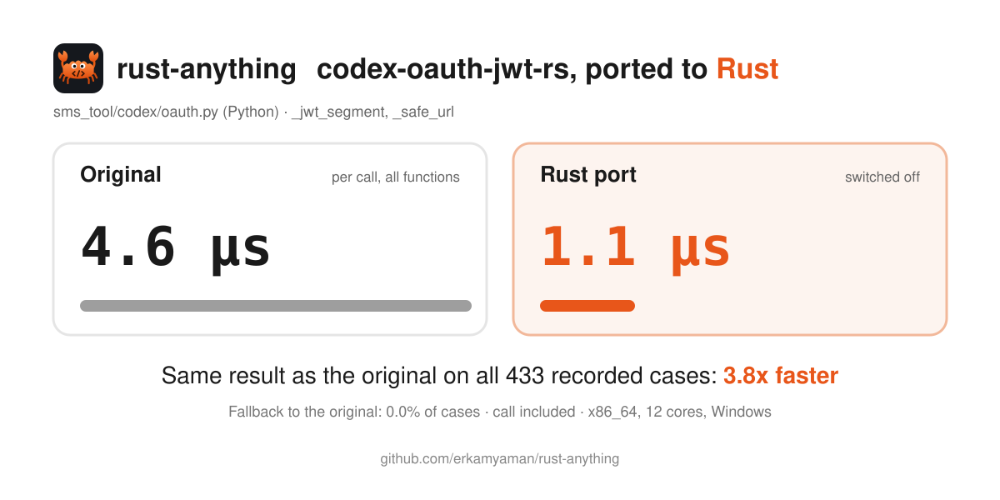

## `codex-oauth-jwt-rs` in Rust

| | |
| --- | --- |
| Unit | `sms_tool/codex/oauth.py` (Python) |
| Recorded cases matched | 433 / 433 |
| Speedup, call included | 3.8x (geometric mean) |
| Fallback to the original | 0.0% (0 of 433 cases) |
| Switched on | off |

| Function | Cases | Original per call | Rust per call | Speedup |
| --- | ---: | ---: | ---: | ---: |
| `_jwt_segment` | 216 | 1.1 µs | 380 ns | 3.0x |
| `_safe_url` | 217 | 3.5 µs | 740 ns | 4.7x |

Measured with `rust-anything report` on x86_64, 12 cores, Windows: `diff` replays every recorded case, `bench` times them on both sides as callers call them. Reproduce: `rust-anything diff` and `rust-anything bench` in the crate folder.
