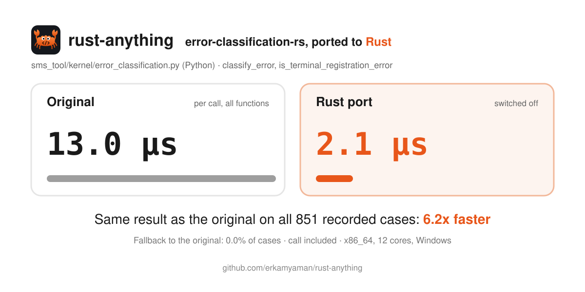

## `error-classification-rs` in Rust

| | |
| --- | --- |
| Unit | `sms_tool/kernel/error_classification.py` (Python) |
| Recorded cases matched | 851 / 851 |
| Speedup, call included | 6.2x (geometric mean) |
| Fallback to the original | 0.0% (0 of 851 cases) |
| Switched on | off |

| Function | Cases | Original per call | Rust per call | Speedup |
| --- | ---: | ---: | ---: | ---: |
| `classify_error` | 451 | 6.1 µs | 1.2 µs | 5.3x |
| `is_terminal_registration_error` | 400 | 6.9 µs | 940 ns | 7.4x |

Measured with `rust-anything report` on x86_64, 12 cores, Windows: `diff` replays every recorded case, `bench` times them on both sides as callers call them. Reproduce: `rust-anything diff` and `rust-anything bench` in the crate folder.
