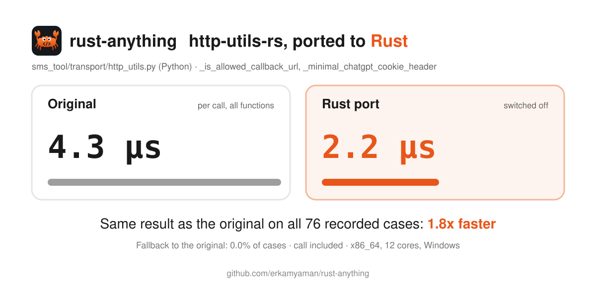

## `http-utils-rs` in Rust

| | |
| --- | --- |
| Unit | `sms_tool/transport/http_utils.py` (Python) |
| Recorded cases matched | 76 / 76 |
| Speedup, call included | 1.8x (geometric mean) |
| Fallback to the original | 0.0% (0 of 76 cases) |
| Switched on | off |

| Function | Cases | Original per call | Rust per call | Speedup |
| --- | ---: | ---: | ---: | ---: |
| `_is_allowed_callback_url` | 46 | 3.2 µs | 1.4 µs | 2.2x |
| `_minimal_chatgpt_cookie_header` | 30 | 1.1 µs | 733 ns | 1.5x |

Measured with `rust-anything report` on x86_64, 12 cores, Windows: `diff` replays every recorded case, `bench` times them on both sides as callers call them. Reproduce: `rust-anything diff` and `rust-anything bench` in the crate folder.
