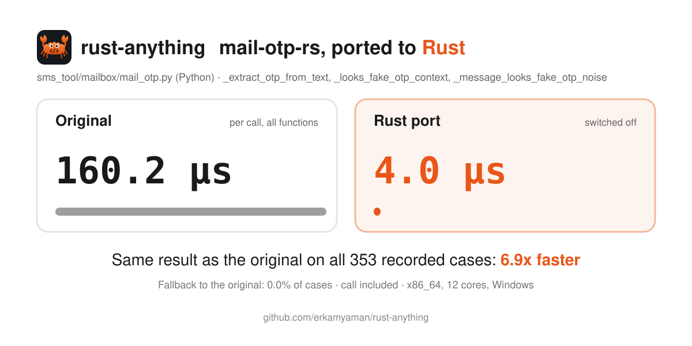

## `mail-otp-rs` in Rust

| | |
| --- | --- |
| Unit | `sms_tool/mailbox/mail_otp.py` (Python) |
| Recorded cases matched | 353 / 353 |
| Speedup, call included | 6.9x (geometric mean) |
| Fallback to the original | 0.0% (0 of 353 cases) |
| Switched on | off |

| Function | Cases | Original per call | Rust per call | Speedup |
| --- | ---: | ---: | ---: | ---: |
| `_extract_otp_from_text` | 295 | 156.6 µs | 2.5 µs | 63x |
| `_looks_fake_otp_context` | 31 | 1.6 µs | 713 ns | 2.2x |
| `_message_looks_fake_otp_noise` | 27 | 1.9 µs | 816 ns | 2.3x |

Measured with `rust-anything report` on x86_64, 12 cores, Windows: `diff` replays every recorded case, `bench` times them on both sides as callers call them. Reproduce: `rust-anything diff` and `rust-anything bench` in the crate folder.
