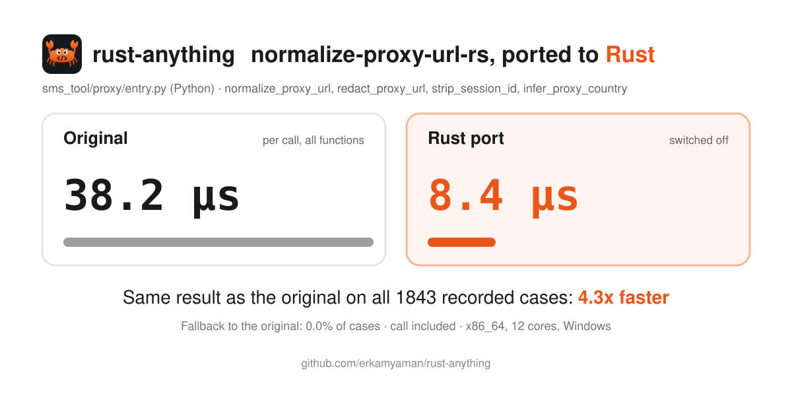

## `normalize-proxy-url-rs` in Rust

| | |
| --- | --- |
| Unit | `sms_tool/proxy/entry.py` (Python) |
| Recorded cases matched | 1843 / 1843 |
| Speedup, call included | 4.3x (geometric mean) |
| Fallback to the original | 0.0% (0 of 1843 cases) |
| Switched on | off |

| Function | Cases | Original per call | Rust per call | Speedup |
| --- | ---: | ---: | ---: | ---: |
| `normalize_proxy_url` | 500 | 3.5 µs | 1.2 µs | 2.9x |
| `redact_proxy_url` | 446 | 10.0 µs | 2.3 µs | 4.3x |
| `strip_session_id` | 462 | 15.4 µs | 3.1 µs | 5.0x |
| `infer_proxy_country` | 435 | 9.3 µs | 1.8 µs | 5.2x |

Measured with `rust-anything report` on x86_64, 12 cores, Windows: `diff` replays every recorded case, `bench` times them on both sides as callers call them. Reproduce: `rust-anything diff` and `rust-anything bench` in the crate folder.
