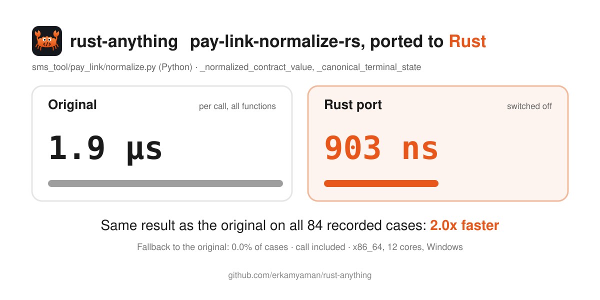

## `pay-link-normalize-rs` in Rust

| | |
| --- | --- |
| Unit | `sms_tool/pay_link/normalize.py` (Python) |
| Recorded cases matched | 84 / 84 |
| Speedup, call included | 2.0x (geometric mean) |
| Fallback to the original | 0.0% (0 of 84 cases) |
| Switched on | off |

| Function | Cases | Original per call | Rust per call | Speedup |
| --- | ---: | ---: | ---: | ---: |
| `_normalized_contract_value` | 42 | 729 ns | 438 ns | 1.7x |
| `_canonical_terminal_state` | 42 | 1.1 µs | 465 ns | 2.4x |

Measured with `rust-anything report` on x86_64, 12 cores, Windows: `diff` replays every recorded case, `bench` times them on both sides as callers call them. Reproduce: `rust-anything diff` and `rust-anything bench` in the crate folder.
