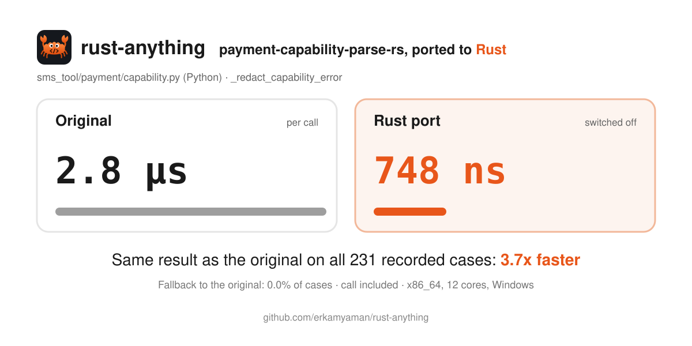

## `payment-capability-parse-rs` in Rust

| | |
| --- | --- |
| Unit | `sms_tool/payment/capability.py` (Python) |
| Recorded cases matched | 231 / 231 |
| Speedup, call included | 3.7x (geometric mean) |
| Fallback to the original | 0.0% (0 of 231 cases) |
| Switched on | off |

| Function | Cases | Original per call | Rust per call | Speedup |
| --- | ---: | ---: | ---: | ---: |
| `_redact_capability_error` | 231 | 2.8 µs | 748 ns | 3.7x |

Measured with `rust-anything report` on x86_64, 12 cores, Windows: `diff` replays every recorded case, `bench` times them on both sides as callers call them. Reproduce: `rust-anything diff` and `rust-anything bench` in the crate folder.
