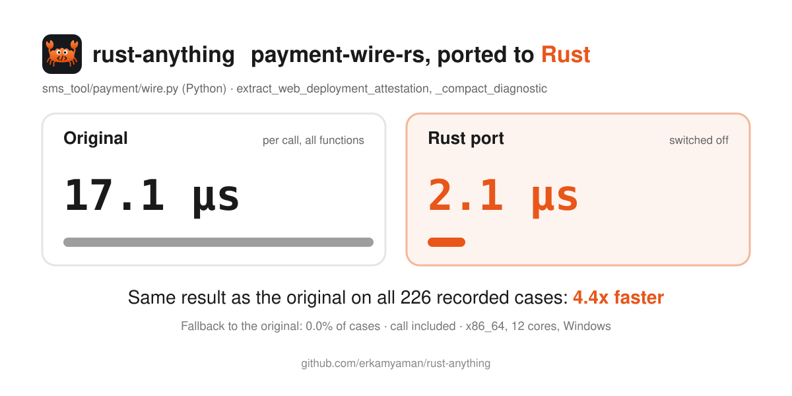

## `payment-wire-rs` in Rust

| | |
| --- | --- |
| Unit | `sms_tool/payment/wire.py` (Python) |
| Recorded cases matched | 226 / 226 |
| Speedup, call included | 4.4x (geometric mean) |
| Fallback to the original | 0.0% (0 of 226 cases) |
| Switched on | off |

| Function | Cases | Original per call | Rust per call | Speedup |
| --- | ---: | ---: | ---: | ---: |
| `extract_web_deployment_attestation` | 24 | 15.8 µs | 1.1 µs | 14x |
| `_compact_diagnostic` | 202 | 1.3 µs | 923 ns | 1.4x |

Measured with `rust-anything report` on x86_64, 12 cores, Windows: `diff` replays every recorded case, `bench` times them on both sides as callers call them. Reproduce: `rust-anything diff` and `rust-anything bench` in the crate folder.
