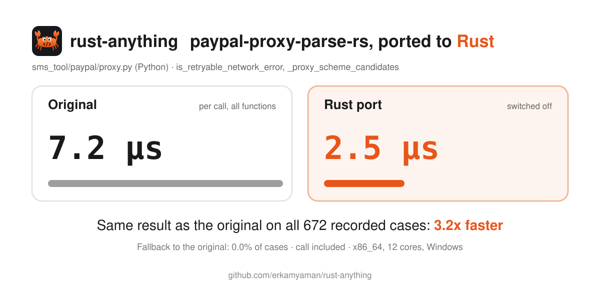

## `paypal-proxy-parse-rs` in Rust

| | |
| --- | --- |
| Unit | `sms_tool/paypal/proxy.py` (Python) |
| Recorded cases matched | 672 / 672 |
| Speedup, call included | 3.2x (geometric mean) |
| Fallback to the original | 0.0% (0 of 672 cases) |
| Switched on | off |

| Function | Cases | Original per call | Rust per call | Speedup |
| --- | ---: | ---: | ---: | ---: |
| `is_retryable_network_error` | 336 | 2.0 µs | 521 ns | 3.7x |
| `_proxy_scheme_candidates` | 336 | 5.2 µs | 1.9 µs | 2.7x |

Measured with `rust-anything report` on x86_64, 12 cores, Windows: `diff` replays every recorded case, `bench` times them on both sides as callers call them. Reproduce: `rust-anything diff` and `rust-anything bench` in the crate folder.
