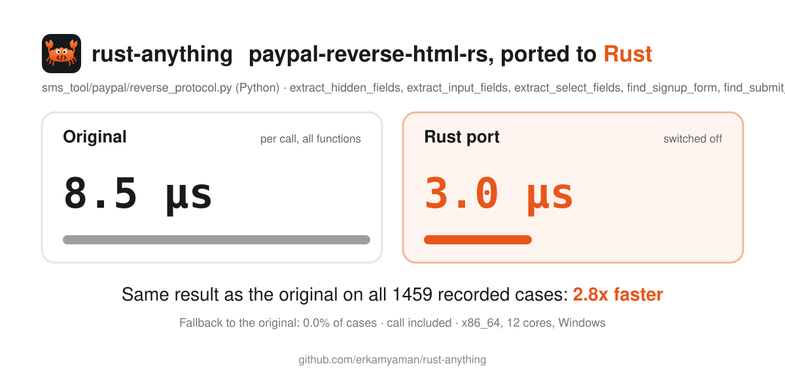

## `paypal-reverse-html-rs` in Rust

| | |
| --- | --- |
| Unit | `sms_tool/paypal/reverse_protocol.py` (Python) |
| Recorded cases matched | 1459 / 1459 |
| Speedup, call included | 2.8x (geometric mean) |
| Fallback to the original | 0.0% (0 of 1459 cases) |
| Switched on | off |

| Function | Cases | Original per call | Rust per call | Speedup |
| --- | ---: | ---: | ---: | ---: |
| `extract_hidden_fields` | 226 | 803 ns | 355 ns | 2.3x |
| `extract_input_fields` | 225 | 847 ns | 415 ns | 2.0x |
| `extract_select_fields` | 225 | 1.6 µs | 460 ns | 3.6x |
| `find_signup_form` | 260 | 1.9 µs | 510 ns | 3.8x |
| `find_submit_form` | 262 | 1.9 µs | 480 ns | 4.1x |
| `extract_challenge_form` | 261 | 1.4 µs | 779 ns | 1.7x |

Measured with `rust-anything report` on x86_64, 12 cores, Windows: `diff` replays every recorded case, `bench` times them on both sides as callers call them. Reproduce: `rust-anything diff` and `rust-anything bench` in the crate folder.
