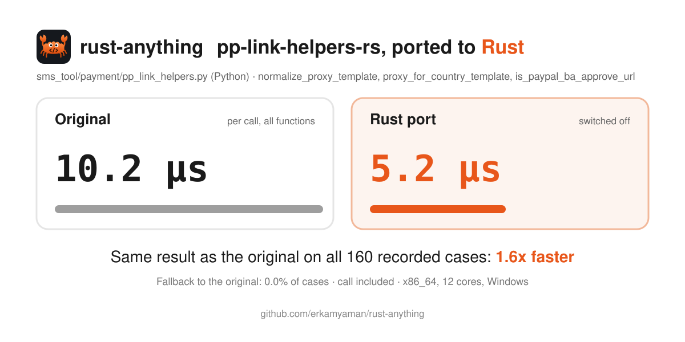

## `pp-link-helpers-rs` in Rust

| | |
| --- | --- |
| Unit | `sms_tool/payment/pp_link_helpers.py` (Python) |
| Recorded cases matched | 160 / 160 |
| Speedup, call included | 1.6x (geometric mean) |
| Fallback to the original | 0.0% (0 of 160 cases) |
| Switched on | off |

| Function | Cases | Original per call | Rust per call | Speedup |
| --- | ---: | ---: | ---: | ---: |
| `normalize_proxy_template` | 38 | 1.7 µs | 1.4 µs | 1.2x |
| `proxy_for_country_template` | 87 | 7.5 µs | 3.0 µs | 2.5x |
| `is_paypal_ba_approve_url` | 35 | 953 ns | 746 ns | 1.3x |

Measured with `rust-anything report` on x86_64, 12 cores, Windows: `diff` replays every recorded case, `bench` times them on both sides as callers call them. Reproduce: `rust-anything diff` and `rust-anything bench` in the crate folder.
