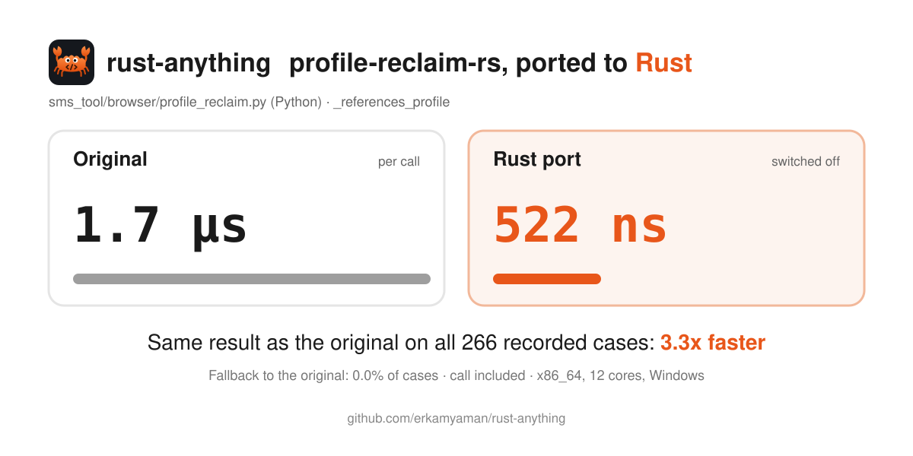

## `profile-reclaim-rs` in Rust

| | |
| --- | --- |
| Unit | `sms_tool/browser/profile_reclaim.py` (Python) |
| Recorded cases matched | 266 / 266 |
| Speedup, call included | 3.3x (geometric mean) |
| Fallback to the original | 0.0% (0 of 266 cases) |
| Switched on | off |

| Function | Cases | Original per call | Rust per call | Speedup |
| --- | ---: | ---: | ---: | ---: |
| `_references_profile` | 266 | 1.7 µs | 522 ns | 3.3x |

Measured with `rust-anything report` on x86_64, 12 cores, Windows: `diff` replays every recorded case, `bench` times them on both sides as callers call them. Reproduce: `rust-anything diff` and `rust-anything bench` in the crate folder.
