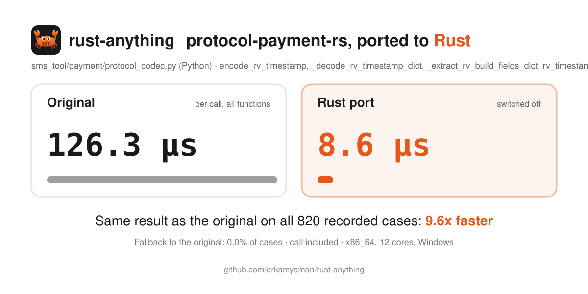

## `protocol-payment-rs` in Rust

| | |
| --- | --- |
| Unit | `sms_tool/payment/protocol_codec.py` (Python) |
| Recorded cases matched | 820 / 820 |
| Speedup, call included | 9.6x (geometric mean) |
| Fallback to the original | 0.0% (0 of 820 cases) |
| Switched on | off |

| Function | Cases | Original per call | Rust per call | Speedup |
| --- | ---: | ---: | ---: | ---: |
| `encode_rv_timestamp` | 430 | 20.7 µs | 2.5 µs | 8.3x |
| `_decode_rv_timestamp_dict` | 41 | 5.9 µs | 1.3 µs | 4.6x |
| `_extract_rv_build_fields_dict` | 36 | 46.0 µs | 1.5 µs | 30x |
| `rv_timestamp_from_script` | 36 | 49.8 µs | 1.5 µs | 32x |
| `_quote_from_payload_str` | 277 | 3.8 µs | 1.7 µs | 2.2x |

Measured with `rust-anything report` on x86_64, 12 cores, Windows: `diff` replays every recorded case, `bench` times them on both sides as callers call them. Reproduce: `rust-anything diff` and `rust-anything bench` in the crate folder.
