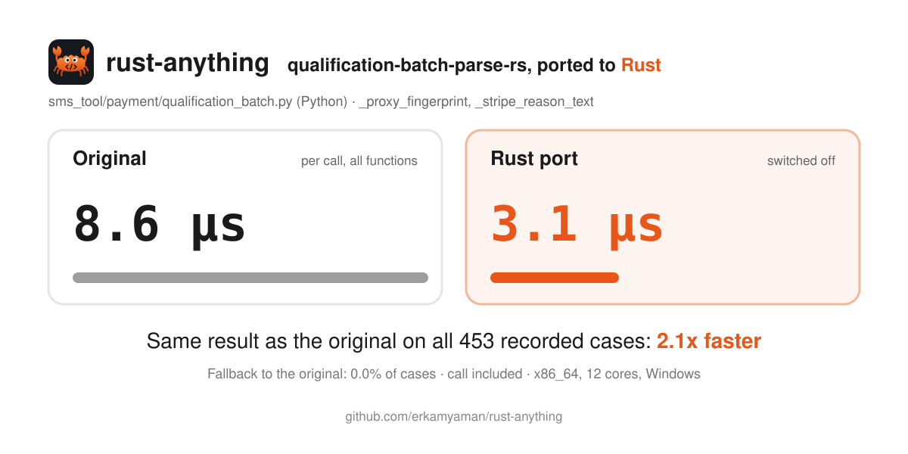

## `qualification-batch-parse-rs` in Rust

| | |
| --- | --- |
| Unit | `sms_tool/payment/qualification_batch.py` (Python) |
| Recorded cases matched | 453 / 453 |
| Speedup, call included | 2.1x (geometric mean) |
| Fallback to the original | 0.0% (0 of 453 cases) |
| Switched on | off |

| Function | Cases | Original per call | Rust per call | Speedup |
| --- | ---: | ---: | ---: | ---: |
| `_proxy_fingerprint` | 227 | 7.1 µs | 1.9 µs | 3.8x |
| `_stripe_reason_text` | 226 | 1.5 µs | 1.3 µs | 1.2x |

Measured with `rust-anything report` on x86_64, 12 cores, Windows: `diff` replays every recorded case, `bench` times them on both sides as callers call them. Reproduce: `rust-anything diff` and `rust-anything bench` in the crate folder.
