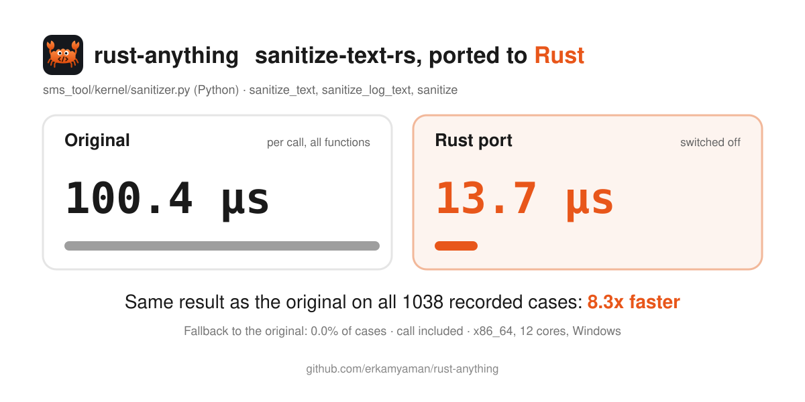

## `sanitize-text-rs` in Rust

| | |
| --- | --- |
| Unit | `sms_tool/kernel/sanitizer.py` (Python) |
| Recorded cases matched | 1038 / 1038 |
| Speedup, call included | 8.3x (geometric mean) |
| Fallback to the original | 0.0% (0 of 1038 cases) |
| Switched on | off |

| Function | Cases | Original per call | Rust per call | Speedup |
| --- | ---: | ---: | ---: | ---: |
| `sanitize_text` | 281 | 20.3 µs | 2.3 µs | 8.9x |
| `sanitize_log_text` | 234 | 38.3 µs | 3.0 µs | 13x |
| `sanitize` | 523 | 41.8 µs | 8.4 µs | 5.0x |

Measured with `rust-anything report` on x86_64, 12 cores, Windows: `diff` replays every recorded case, `bench` times them on both sides as callers call them. Reproduce: `rust-anything diff` and `rust-anything bench` in the crate folder.
