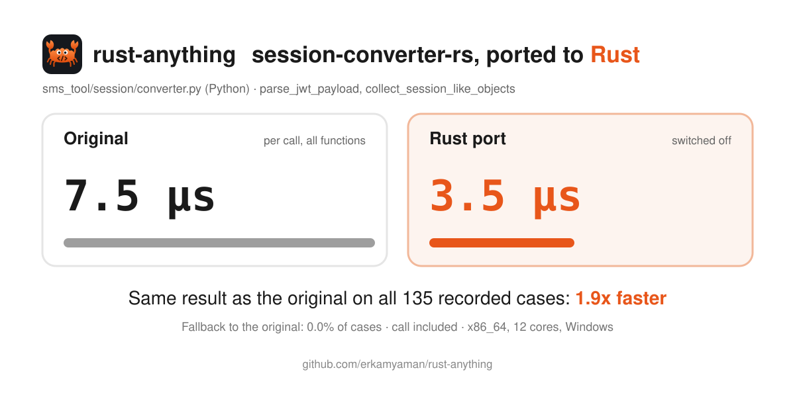

## `session-converter-rs` in Rust

| | |
| --- | --- |
| Unit | `sms_tool/session/converter.py` (Python) |
| Recorded cases matched | 135 / 135 |
| Speedup, call included | 1.9x (geometric mean) |
| Fallback to the original | 0.0% (0 of 135 cases) |
| Switched on | off |

| Function | Cases | Original per call | Rust per call | Speedup |
| --- | ---: | ---: | ---: | ---: |
| `parse_jwt_payload` | 25 | 1.6 µs | 1.2 µs | 1.4x |
| `collect_session_like_objects` | 110 | 5.9 µs | 2.4 µs | 2.5x |

Measured with `rust-anything report` on x86_64, 12 cores, Windows: `diff` replays every recorded case, `bench` times them on both sides as callers call them. Reproduce: `rust-anything diff` and `rust-anything bench` in the crate folder.
