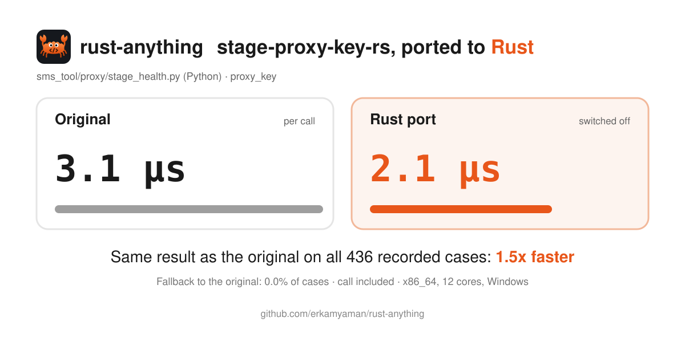

## `stage-proxy-key-rs` in Rust

| | |
| --- | --- |
| Unit | `sms_tool/proxy/stage_health.py` (Python) |
| Recorded cases matched | 436 / 436 |
| Speedup, call included | 1.5x (geometric mean) |
| Fallback to the original | 0.0% (0 of 436 cases) |
| Switched on | off |

| Function | Cases | Original per call | Rust per call | Speedup |
| --- | ---: | ---: | ---: | ---: |
| `proxy_key` | 436 | 3.1 µs | 2.1 µs | 1.5x |

Measured with `rust-anything report` on x86_64, 12 cores, Windows: `diff` replays every recorded case, `bench` times them on both sides as callers call them. Reproduce: `rust-anything diff` and `rust-anything bench` in the crate folder.
