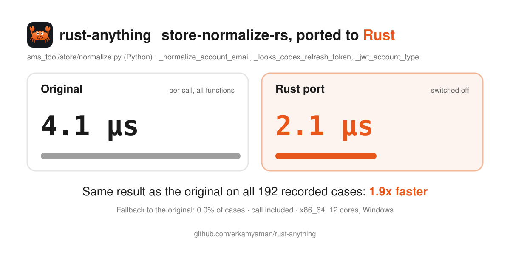

## `store-normalize-rs` in Rust

| | |
| --- | --- |
| Unit | `sms_tool/store/normalize.py` (Python) |
| Recorded cases matched | 192 / 192 |
| Speedup, call included | 1.9x (geometric mean) |
| Fallback to the original | 0.0% (0 of 192 cases) |
| Switched on | off |

| Function | Cases | Original per call | Rust per call | Speedup |
| --- | ---: | ---: | ---: | ---: |
| `_normalize_account_email` | 103 | 895 ns | 566 ns | 1.6x |
| `_looks_codex_refresh_token` | 43 | 1.7 µs | 629 ns | 2.8x |
| `_jwt_account_type` | 46 | 1.5 µs | 873 ns | 1.7x |

Measured with `rust-anything report` on x86_64, 12 cores, Windows: `diff` replays every recorded case, `bench` times them on both sides as callers call them. Reproduce: `rust-anything diff` and `rust-anything bench` in the crate folder.
