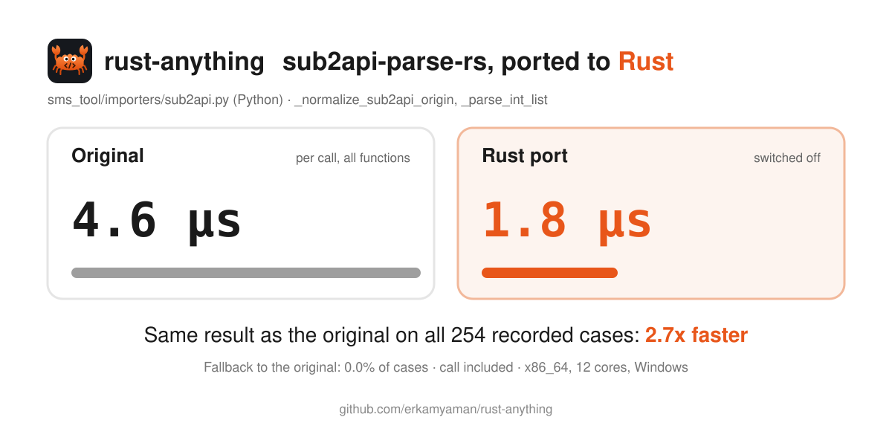

## `sub2api-parse-rs` in Rust

| | |
| --- | --- |
| Unit | `sms_tool/importers/sub2api.py` (Python) |
| Recorded cases matched | 254 / 254 |
| Speedup, call included | 2.7x (geometric mean) |
| Fallback to the original | 0.0% (0 of 254 cases) |
| Switched on | off |

| Function | Cases | Original per call | Rust per call | Speedup |
| --- | ---: | ---: | ---: | ---: |
| `_normalize_sub2api_origin` | 236 | 2.1 µs | 609 ns | 3.5x |
| `_parse_int_list` | 18 | 2.5 µs | 1.2 µs | 2.1x |

Measured with `rust-anything report` on x86_64, 12 cores, Windows: `diff` replays every recorded case, `bench` times them on both sides as callers call them. Reproduce: `rust-anything diff` and `rust-anything bench` in the crate folder.
